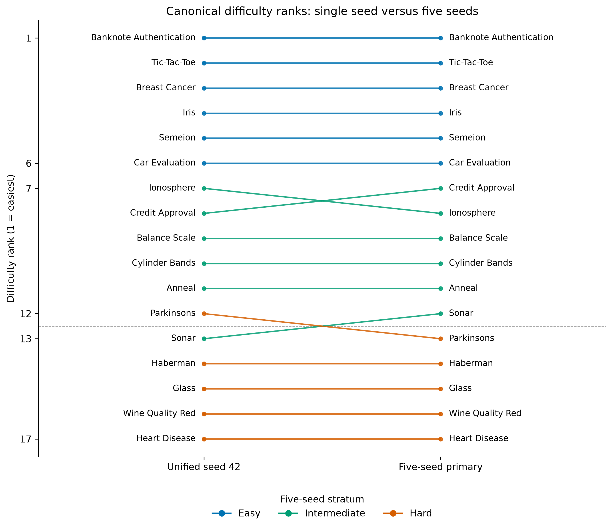
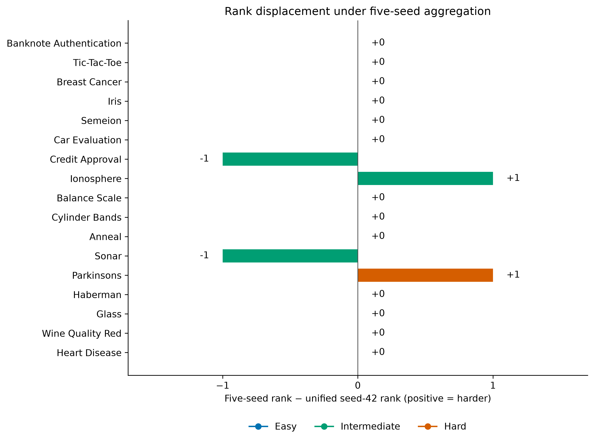
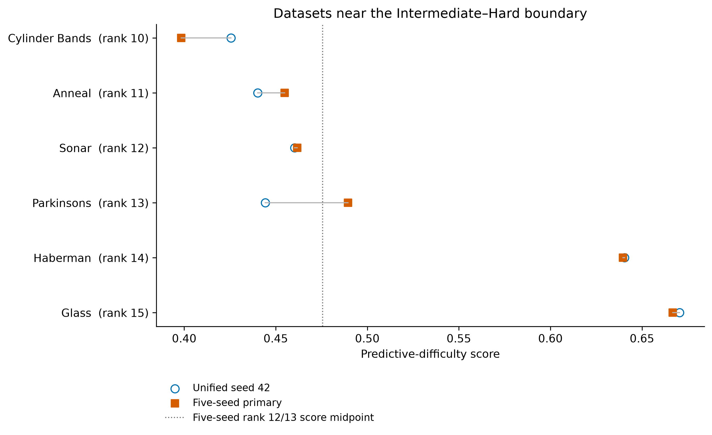
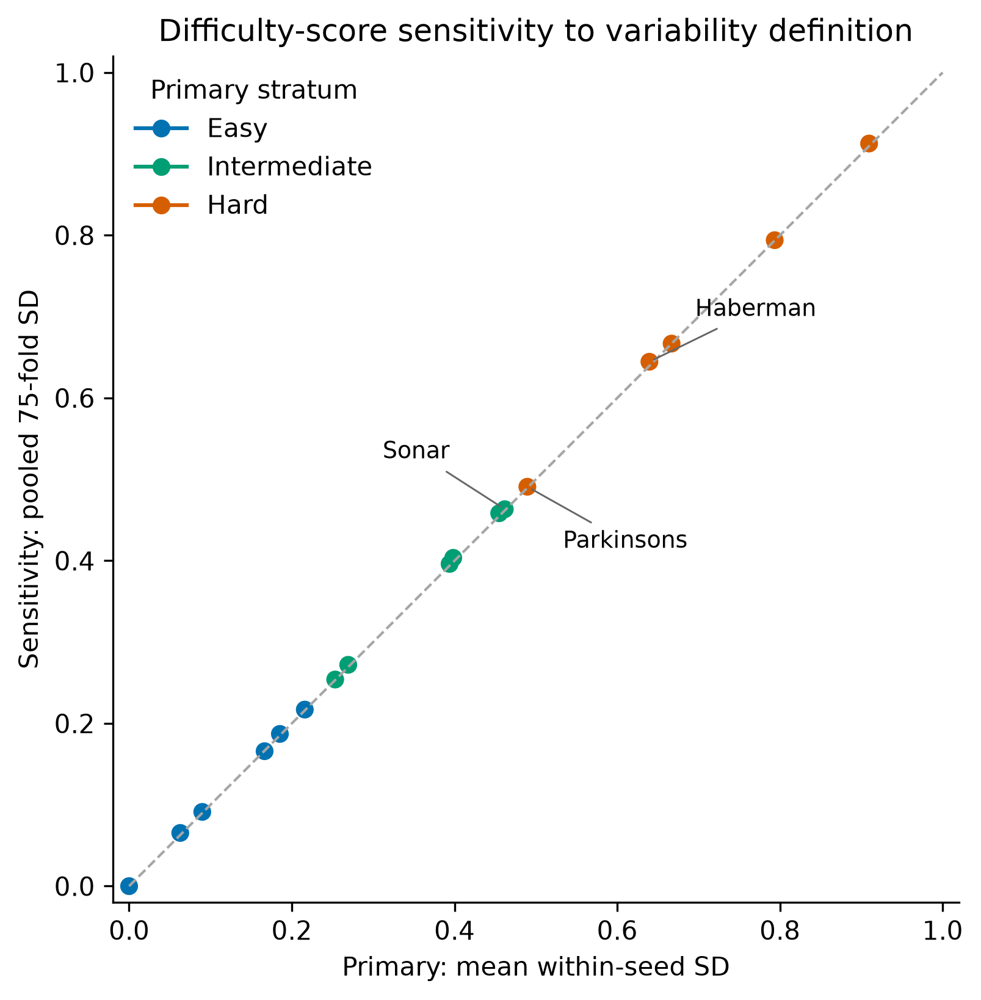

# Block 3 — Five-seed aggregated canonical difficulty ranking

## Findings

The primary unified seed-42 versus five-seed comparison changes **4 of 17 ranks**
and **2 of 17 stratum assignments (11.7647%)**.
Spearman rank correlation is **0.9951** and Kendall tau-b is
**0.9706**. Mean absolute rank displacement is
**0.2353**, with maximum
**1** positions.

Sonar's actual primary aggregated assignment is **Intermediate**,
at rank **12**. Parkinsons is
**Hard**, at rank
**13**. These are computed findings,
not an assumed outcome of the reviewer's suggestion.

## Provenance and completeness

All **20,400 official successful evaluations** passed the existing checkpoint
checksum, runner provenance and result-schema validators. The exact Cartesian
grid includes 17 datasets, 16 configurations, 5 seeds, 3 repetitions and 5 folds.
All evaluation IDs are unique, all scores finite and in [0,1], and the dataset
fingerprints, resolved model configurations and saved split identities match.
No pilot, failed, missing or corrupt score was included. Exactly **5,100** records
belong to the four canonical models, with 15 scores per seed/model/dataset and
75 per model/dataset. No model was fit or evaluated and no split regenerated.

Canonical selection is only DT default, DT balanced, LR default and LR balanced.
SVM, RIPPER, dummy baselines and all regularized trees were validated as part of
the full store but excluded from scoring. Official input:
`experiments/results/official/revision2-five-seed-v1/block2b-five-seed/`.
Its run manifest hash is `88f8cb9415479380290438ddcfaeaaebad030032ea921e8f5cd0232fd53e5000`.
The complete record checksum inventory is exported separately.

## Definition and reference identities

A = manuscript-era stored seed-42 profile at
`results\dataset_statistics\dataset_experimental_profile.csv` with its original `reproducibility.json`.
B = reconstructed seed 42 from the new official unified-environment results.
C = five-seed primary, using mean within-seed SD.
D = `five_seed_pooled_sd_sensitivity`.

The later profile at
`results/new_characterization_experiments/tables/dataset_experimental_profile.csv`
is a cleaned-notebook reproduction, not A. Its stored history note identifies A
as the older reference. Both older profiles have the same ranks/labels but differ
slightly numerically. This distinction prevents silently choosing the newer
reproduction as the manuscript-era comparison. The actual publication's exact
bytes were not independently verified.

For each model/seed, mean and sample SD use its 15 scores (`ddof=1`). For C,
average the five means and the five SDs separately; then average across the four
canonical models to obtain F and V, with E = 1 − F. Equal fold counts make the
five-mean average equivalent to the direct 75-score mean; this was numerically
checked for all 68 dataset/model pairs. D instead uses each model's sample SD
over 75 scores, then averages those four SDs.

Original notebook normalization, tie-breaking and assignment function bodies are
reused in `canonical_scoring.py`. E and V are min-max normalized separately on
the fixed 17 datasets; constant components map to zero. The score remains exactly
**0.70 × normalized E + 0.30 × normalized V**. Ordering uses exact score equality,
then higher F, lower V and dataset name; stable sorting and `numpy.array_split`
produce Easy/Intermediate/Hard groups of **6/6/5**. No pre-ranking rounding occurs.
The canonical literal 0.30 is retained, matching the original main score and
alignment helper; the generic panel helper's `1-alpha` differs only in possible
last-bit floating-point arithmetic and is not substituted for the canonical formula.

The user's Block 3 instruction explicitly resolves the formerly pending
variability choice in favor of C. Evaluation configs were not modified: this
analysis choice is recorded in Block 3 provenance, preserving runner identities.

## Full primary five-seed ranking

Numbers below are display-rounded to four decimals only. CSV exports retain
17 significant digits.

| dataset | mean_macro_f1 | error | variability | normalized_error | normalized_variability | difficulty_score | rank | stratum |
| --- | --- | --- | --- | --- | --- | --- | --- | --- |
| Banknote Authentication | 0.9821 | 0.0179 | 0.0071 | 0.0000 | 0.0000 | 0.0000 | 1 | easy |
| Tic-Tac-Toe | 0.9534 | 0.0466 | 0.0152 | 0.0419 | 0.1118 | 0.0629 | 2 | easy |
| Breast Cancer | 0.9472 | 0.0528 | 0.0202 | 0.0510 | 0.1808 | 0.0899 | 3 | easy |
| Iris | 0.9489 | 0.0511 | 0.0390 | 0.0485 | 0.4419 | 0.1665 | 4 | easy |
| Semeion | 0.8340 | 0.1660 | 0.0153 | 0.2161 | 0.1134 | 0.1853 | 5 | easy |
| Car Evaluation | 0.8670 | 0.1330 | 0.0308 | 0.1680 | 0.3279 | 0.2159 | 6 | easy |
| Credit Approval | 0.8324 | 0.1676 | 0.0313 | 0.2185 | 0.3346 | 0.2533 | 7 | intermediate |
| Ionosphere | 0.8659 | 0.1341 | 0.0434 | 0.1696 | 0.5021 | 0.2693 | 8 | intermediate |
| Balance Scale | 0.6554 | 0.3446 | 0.0216 | 0.4768 | 0.2007 | 0.3939 | 9 | intermediate |
| Cylinder Bands | 0.7512 | 0.2488 | 0.0463 | 0.3369 | 0.5419 | 0.3984 | 10 | intermediate |
| Anneal | 0.7853 | 0.2147 | 0.0683 | 0.2872 | 0.8461 | 0.4549 | 11 | intermediate |
| Sonar | 0.7452 | 0.2548 | 0.0601 | 0.3457 | 0.7325 | 0.4618 | 12 | intermediate |
| Parkinsons | 0.7869 | 0.2131 | 0.0770 | 0.2849 | 0.9669 | 0.4895 | 13 | hard |
| Haberman | 0.5720 | 0.4280 | 0.0603 | 0.5984 | 0.7356 | 0.6395 | 14 | hard |
| Glass | 0.6230 | 0.3770 | 0.0794 | 0.5240 | 1.0000 | 0.6668 | 15 | hard |
| Wine Quality Red | 0.3210 | 0.6790 | 0.0356 | 0.9647 | 0.3942 | 0.7935 | 16 | hard |
| Heart Disease | 0.2968 | 0.7032 | 0.0576 | 1.0000 | 0.6986 | 0.9096 | 17 | hard |

## Historical versus unified seed 42 (A versus B)

A→B changes **0 ranks** and **0 strata**.
Spearman = 1.0000; Kendall tau-b = 1.0000.
This is a reproducibility/environment-change check, not evidence that one
environment is superior or that all differences can be causally attributed to
library versions. Historical CSV identities/string dtypes and execution histories
were documented in Blocks 1–2. Exact historical SVM/RIPPER pairing is irrelevant
to this four-model calculation and remains unverified.

The complete component differences (B minus A) are:

| dataset | mean_macro_f1_difference | error_difference | variability_difference | difficulty_score_difference | rank_difference | stratum_changed |
| --- | --- | --- | --- | --- | --- | --- |
| Banknote Authentication | 0.0000 | 0.0000 | 0.0000 | 0.0000 | 0 | False |
| Tic-Tac-Toe | -0.0001 | 0.0001 | 0.0001 | 0.0005 | 0 | False |
| Breast Cancer | 0.0000 | 0.0000 | 0.0000 | -0.0000 | 0 | False |
| Iris | 0.0000 | -0.0000 | 0.0000 | -0.0000 | 0 | False |
| Semeion | 0.0006 | -0.0006 | 0.0005 | 0.0011 | 0 | False |
| Car Evaluation | 0.0005 | -0.0005 | 0.0002 | 0.0001 | 0 | False |
| Ionosphere | -0.0002 | 0.0002 | 0.0000 | 0.0002 | 0 | False |
| Credit Approval | -0.0011 | 0.0011 | -0.0017 | -0.0056 | 0 | False |
| Balance Scale | -0.0001 | 0.0001 | 0.0001 | 0.0001 | 0 | False |
| Cylinder Bands | -0.0012 | 0.0012 | -0.0006 | -0.0014 | 0 | False |
| Anneal | -0.0018 | 0.0018 | 0.0000 | 0.0018 | 0 | False |
| Parkinsons | 0.0000 | 0.0000 | 0.0000 | -0.0001 | 0 | False |
| Sonar | 0.0000 | 0.0000 | 0.0000 | -0.0002 | 0 | False |
| Haberman | -0.0024 | 0.0024 | 0.0007 | 0.0049 | 0 | False |
| Glass | 0.0000 | 0.0000 | 0.0000 | -0.0003 | 0 | False |
| Wine Quality Red | 0.0000 | -0.0000 | 0.0012 | 0.0043 | 0 | False |
| Heart Disease | -0.0005 | 0.0005 | 0.0010 | 0.0040 | 0 | False |

## Ranking comparisons

All correlations below compare deterministic ordinal ranks, not p-values.

| comparison | spearman_rank | kendall_tau_b | changed_ranks | changed_strata | changed_strata_percent | mean_absolute_rank_displacement | maximum_absolute_rank_displacement |
| --- | --- | --- | --- | --- | --- | --- | --- |
| A_vs_B | 1.0000 | 1.0000 | 0 | 0 | 0.0000 | 0.0000 | 0 |
| B_vs_C | 0.9951 | 0.9706 | 4 | 2 | 11.7647 | 0.2353 | 1 |
| C_vs_D | 1.0000 | 1.0000 | 0 | 0 | 0.0000 | 0.0000 | 0 |
| A_vs_C | 0.9951 | 0.9706 | 4 | 2 | 11.7647 | 0.2353 | 1 |
| B_vs_D | 0.9951 | 0.9706 | 4 | 2 | 11.7647 | 0.2353 | 1 |
| A_vs_D | 0.9951 | 0.9706 | 4 | 2 | 11.7647 | 0.2353 | 1 |

Primary B→C changes by dataset:

| dataset | historical_rank | historical_stratum | new_seed42_rank | new_seed42_stratum | five_seed_rank | five_seed_stratum | score_difference | rank_displacement | stratum_changed |
| --- | --- | --- | --- | --- | --- | --- | --- | --- | --- |
| Banknote Authentication | 1 | easy | 1 | easy | 1 | easy | 0.0000 | 0 | False |
| Tic-Tac-Toe | 2 | easy | 2 | easy | 2 | easy | -0.0060 | 0 | False |
| Breast Cancer | 3 | easy | 3 | easy | 3 | easy | 0.0091 | 0 | False |
| Iris | 4 | easy | 4 | easy | 4 | easy | 0.0032 | 0 | False |
| Semeion | 5 | easy | 5 | easy | 5 | easy | 0.0013 | 0 | False |
| Car Evaluation | 6 | easy | 6 | easy | 6 | easy | -0.0017 | 0 | False |
| Ionosphere | 7 | intermediate | 7 | intermediate | 8 | intermediate | 0.0238 | 1 | False |
| Credit Approval | 8 | intermediate | 8 | intermediate | 7 | intermediate | -0.0148 | -1 | False |
| Balance Scale | 9 | intermediate | 9 | intermediate | 9 | intermediate | -0.0040 | 0 | False |
| Cylinder Bands | 10 | intermediate | 10 | intermediate | 10 | intermediate | -0.0271 | 0 | False |
| Anneal | 11 | intermediate | 11 | intermediate | 11 | intermediate | 0.0147 | 0 | False |
| Parkinsons | 12 | intermediate | 12 | intermediate | 13 | hard | 0.0453 | 1 | True |
| Sonar | 13 | hard | 13 | hard | 12 | intermediate | 0.0015 | -1 | True |
| Haberman | 14 | hard | 14 | hard | 14 | hard | -0.0010 | 0 | False |
| Glass | 15 | hard | 15 | hard | 15 | hard | -0.0036 | 0 | False |
| Wine Quality Red | 16 | hard | 16 | hard | 16 | hard | 0.0122 | 0 | False |
| Heart Disease | 17 | hard | 17 | hard | 17 | hard | 0.0058 | 0 | False |

## Sonar, Parkinsons, Haberman and boundary changes

- **Sonar:** historical D=0.4604, rank 13 (hard); unified seed-42 D=0.4603, rank 13 (hard); five-seed D=0.4618, rank 12 (intermediate). B→C displacement: -1. Immediate easier/harder neighbors: Anneal / Parkinsons. Signed distance to the rank-12/13 midpoint: -0.5000 rank positions and -0.0139 score units; 1 rank move(s) required to cross that boundary.
- **Parkinsons:** historical D=0.4444, rank 12 (intermediate); unified seed-42 D=0.4442, rank 12 (intermediate); five-seed D=0.4895, rank 13 (hard). B→C displacement: +1. Immediate easier/harder neighbors: Sonar / Haberman. Signed distance to the rank-12/13 midpoint: +0.5000 rank positions and +0.0139 score units; 1 rank move(s) required to cross that boundary.
- **Haberman:** historical D=0.6356, rank 14 (hard); unified seed-42 D=0.6405, rank 14 (hard); five-seed D=0.6395, rank 14 (hard). B→C displacement: +0. Immediate easier/harder neighbors: Parkinsons / Glass. Signed distance to the rank-12/13 midpoint: +1.5000 rank positions and +0.1639 score units; 2 rank move(s) required to cross that boundary.

The midpoint at rank 12.5 and the average score of ranks 12 and 13 are descriptive distance conventions only. Strata are assigned by ordered group membership, not by a newly introduced score threshold.

Primary boundary crossers: Parkinsons, Sonar.

Observed per-seed results in the new unified environment (not assumed from reviewer recollection):

| dataset | seed | difficulty_score | rank | stratum |
| --- | --- | --- | --- | --- |
| Haberman | 7 | 0.6531 | 15 | hard |
| Haberman | 21 | 0.6531 | 14 | hard |
| Haberman | 42 | 0.6405 | 14 | hard |
| Haberman | 84 | 0.5932 | 14 | hard |
| Haberman | 123 | 0.6374 | 14 | hard |
| Parkinsons | 7 | 0.4951 | 13 | hard |
| Parkinsons | 21 | 0.5026 | 13 | hard |
| Parkinsons | 42 | 0.4442 | 12 | intermediate |
| Parkinsons | 84 | 0.4747 | 13 | hard |
| Parkinsons | 123 | 0.4987 | 12 | intermediate |
| Sonar | 7 | 0.4767 | 12 | intermediate |
| Sonar | 21 | 0.4572 | 12 | intermediate |
| Sonar | 42 | 0.4603 | 13 | hard |
| Sonar | 84 | 0.4742 | 12 | intermediate |
| Sonar | 123 | 0.4154 | 11 | intermediate |

The other rank exchange is Credit Approval (8 → 7) and Ionosphere (7 → 8); both remain Intermediate. Sonar is Intermediate under all four alternative seeds in the new unified evaluation, whereas Parkinsons is Hard for seeds 7, 21 and 84 and Intermediate for seeds 42 and 123. Haberman stays Hard for all five seeds.

Parkinsons' mean within-seed variability increases from 0.0682 at seed 42 to 0.0770 across five seeds, while its mean F1 improves slightly from 0.7838 to 0.7869. Its normalized variability component rises from 0.8023 to 0.9669. Sonar's raw variability decreases from 0.0620 to 0.0601. Sonar's score nevertheless rises slightly (0.4603 → 0.4618) while its rank improves: both normalization and rank are relative to the fixed pool, and Parkinsons' score increases more. This is not an absolute-performance threshold interpretation.

## Pooled-SD sensitivity and interpretation

C→D yields Spearman **1.0000**, Kendall tau-b
**1.0000**, **0 rank changes**,
and **0 stratum changes**. The full D ranking is
exported separately. Pooled SD incorporates both within-seed variation and
between-seed mean differences; it is not numerically interchangeable with the
mean of within-seed SDs. The finite-sample denominator also differs, so pooled SD
need not be greater than mean within-seed SD.

The primary formulation preserves the original within-CV variability interpretation
while reducing dependence on the choice of a single seed. More folds alone do
not establish that the ranking is better. Repeated-CV folds overlap and are not
75 independent experimental replicates. No significance tests, independence-based
confidence intervals or causal environment claims are made.

## Tables, figures and reproducibility

Output directory: `experiments/analysis/block3-five-seed-v1/`.

- Four separate full rankings: historical A, unified seed42 B, primary C, pooled-SD D.
- `canonical_fold_scores.csv`: the validated 5,100 canonical scores.
- `seed_model_statistics.csv`: 340 dataset/model/seed means and sample SDs.
- `five_seed_model_statistics.csv`: 68 aggregated model rows, including both SD definitions.
- `per_seed_rankings.csv`: 85 dataset/seed rankings and labels for later Block 5.
- `comparison_details.csv`, `comparison_summary.csv`, `ranking_comparison.csv`:
  all six pairwise comparisons, exact component differences and boundary crossers.
- `boundary_focus.csv`: Sonar, Parkinsons, Haberman and all datasets changing
  assignments in any comparison, with primary-ranking neighbors and distances.
- `provenance.json`, `official_record_checksums.json`, `output_checksums.json`:
  input identity, method decisions and export integrity.

Publication plots are saved as 300-dpi PNG and vector PDF, with full dataset names:









Only a clearly marked analysis-only section is appended to
`New_Characterization_Experiments.ipynb`. Existing cells/results are preserved.
Execute the appended cells independently; the older notebook sections still
contain historical fitting workflows and must not be run for this analysis.
The new section loads verified exports through the shared module; it does not
duplicate scoring, runner or preprocessing implementations. Reproduction requires
the local official store, original CSVs, saved partitions and historical references,
which are not all tracked by Git. CSV/PDF/PNG files may also be locally ignored.

```powershell
.venv/Scripts/python.exe -m unittest experiments.protocol.test_block3 -v
.venv/Scripts/python.exe -m experiments.protocol.block3_analysis --output experiments/analysis/block3-five-seed-reproduction
```

The analysis command refuses to overwrite an existing output directory. All
20,400 records must pass validation before ranking computation. Parallelism is
limited to read-only checkpoint validation; no estimators are fitted. Extraction
provenance is in `protocol/block3_scoring_provenance.json`. Six lightweight tests
passed: canonical selection/completeness, 15/75 counts, means/SDs and ddof,
normalization/constants, weights/strata/names, exact ties/unrounded ordering and
original notebook-function cross-checks. Final preservation checks are recorded
in `protocol/block3_validation_report.json`.

Created: `block3_analysis.py`, `canonical_scoring.py`, `block3_figures.py`,
`block3_report.py`, `test_block3.py`, provenance/validation records, this report
and the Block 3 output directory. Modified: only the target notebook, by appending
the Block 3 section. Existing runner/config/data/model/preprocessing files and
unrelated notebooks are unchanged. No environment changes, commits, pushes, merges or branch changes.

## Reviewer traceability and next blocks

| Comment | Evidence provided | Deferred work |
| --- | --- | --- |
| R1.2a | B→C rank/stratum changes and explicit Sonar/Parkinsons boundary results | Manuscript adoption remains an editorial decision |
| R1.2b | Complete per-seed components, scores, ranks and strata | Combined seed/alpha label-stability column in Block 5 |
| R1.1 | Original score retained as the uncorrected reference | Chance correction in Block 4 |

Block 4 should compare the preserved primary score to a separately defined
chance-corrected alternative. Block 5 should finalize and calculate the combined
seed/alpha stability definition. Neither analysis was performed here, and no
historical or manuscript ranking was automatically replaced.
