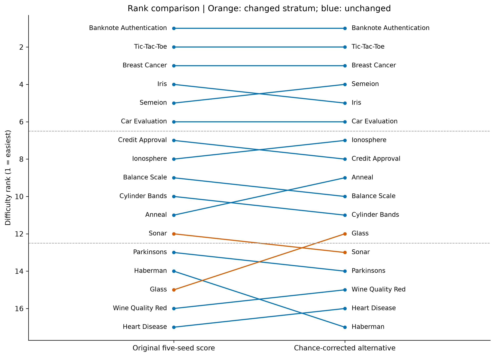
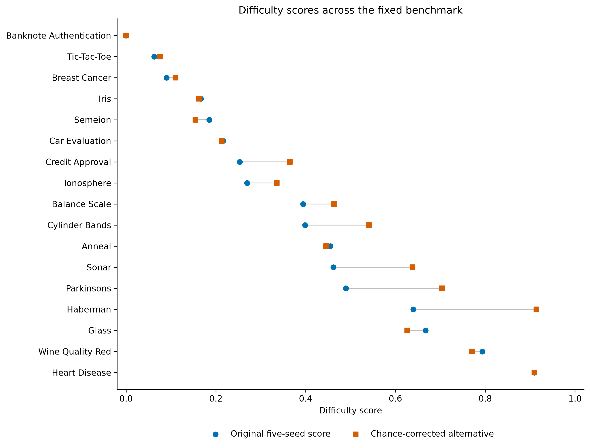
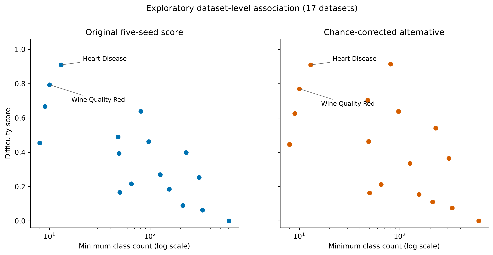
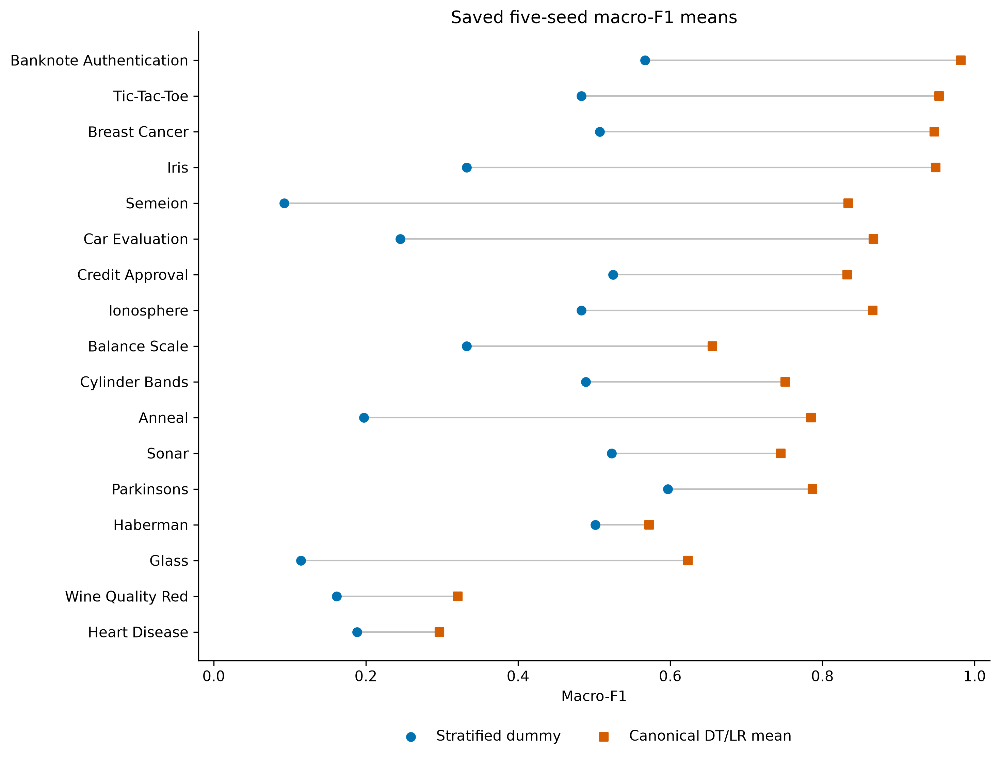

# Block 4 — Chance-corrected predictive difficulty

The corrected composite ranking changes 13 of 17 ranks and 2 of 17 strata (11.76%). Glass moves from rank 15 Hard to rank 12 Intermediate; Sonar moves from rank 12 Intermediate to rank 13 Hard. No dataset crosses the Easy–Intermediate boundary. Spearman agreement is 0.9608 and Kendall tau-b is 0.8676; mean absolute displacement is 1.0588 ranks and the maximum is 3. Heart Disease and Wine Quality Red both remain Hard.

## Scope and method

This is a comparative sensitivity analysis, not a replacement of the proposed canonical score. The primary reference is the Block 3 five-seed ranking. All 20,400 official successful records were validated using the existing Block 3/runner provenance checks; 5,100 canonical and 2,550 dummy records are used here. Every dataset/model has five seeds [42, 7, 21, 84, 123], 15 saved evaluations per seed and 75 overall. Pilot records are excluded.

Seed-level means and sample SDs (ddof=1) are computed first. F is the equally weighted mean of four DT/LR model means; F_dummy is the five-seed stratified-dummy mean. E_cc = (1 − F)/(1 − F_dummy), I = (F − F_dummy)/(1 − F_dummy). Correction is applied to aggregate means, never averaged fold ratios. D_cc = 0.70 minmax(E_cc) + 0.30 V_norm. Block 3 V and V_norm are unchanged. The shared original normalization and exact tie-breaking functions are reused: score ascending, original F descending, V ascending, dataset name; stable ordering and 6/6/5 rank strata.

All denominators are positive; the smallest is 0.40304968. The explicit near-zero guard is sqrt(machine epsilon), approximately 1.49e-8. No negative improvements, errors outside [0,1], clipping or unstable denominators occurred. Pathological inputs raise an error and stop analysis.

The frozen experimental configuration contains archival planning placeholders. It is intentionally unchanged because it belongs to the official run provenance; the approved Block 4 formula and decisions are recorded in this analysis’s provenance.json.

## Dummy references for all 17 datasets

The CSV additionally records five seed means and SDs, both 75-fold pooled SDs, fold minima/maxima, class counts, majority proportions, and imbalance ratios. Imbalance ratio is maximum/minimum class count; all 17 have positive class counts. The two reference strategies remain separate.

| dataset_name | dummy_most_frequent_mean_f1 | dummy_most_frequent_mean_within_seed_sd | dummy_most_frequent_pooled_sd | dummy_stratified_mean_f1 | dummy_stratified_mean_within_seed_sd | dummy_stratified_pooled_sd |
| --- | --- | --- | --- | --- | --- | --- |
| Anneal | 0.1730 | 0.0001 | 0.0001 | 0.1973 | 0.0291 | 0.0302 |
| Balance Scale | 0.2093 | 0.0010 | 0.0010 | 0.3326 | 0.0340 | 0.0343 |
| Banknote Authentication | 0.3571 | 0.0003 | 0.0003 | 0.5669 | 0.0027 | 0.0026 |
| Breast Cancer | 0.3855 | 0.0015 | 0.0015 | 0.5073 | 0.0448 | 0.0452 |
| Car Evaluation | 0.2059 | 0.0002 | 0.0002 | 0.2450 | 0.0167 | 0.0167 |
| Credit Approval | 0.3569 | 0.0015 | 0.0015 | 0.5246 | 0.0282 | 0.0306 |
| Cylinder Bands | 0.3662 | 0.0019 | 0.0018 | 0.4891 | 0.0439 | 0.0443 |
| Glass | 0.0873 | 0.0017 | 0.0016 | 0.1146 | 0.0016 | 0.0016 |
| Haberman | 0.4237 | 0.0016 | 0.0016 | 0.5015 | 0.0519 | 0.0542 |
| Heart Disease | 0.1405 | 0.0009 | 0.0009 | 0.1883 | 0.0486 | 0.0492 |
| Ionosphere | 0.3906 | 0.0014 | 0.0014 | 0.4832 | 0.0613 | 0.0615 |
| Iris | 0.1667 | 0.0000 | 0.0000 | 0.3323 | 0.0000 | 0.0000 |
| Parkinsons | 0.4298 | 0.0042 | 0.0041 | 0.5970 | 0.0815 | 0.0842 |
| Semeion | 0.0183 | 0.0000 | 0.0000 | 0.0924 | 0.0183 | 0.0185 |
| Sonar | 0.3480 | 0.0040 | 0.0039 | 0.5231 | 0.0084 | 0.0081 |
| Tic-Tac-Toe | 0.3952 | 0.0008 | 0.0008 | 0.4830 | 0.0037 | 0.0036 |
| Wine Quality Red | 0.0996 | 0.0002 | 0.0002 | 0.1613 | 0.0162 | 0.0164 |

## Full corrected ranking and original comparison

Positive rank displacement means a move toward the harder end. All CSV values retain round-trip precision; only presentation values are rounded.

| dataset_name | original_mean_macro_f1 | stratified_dummy_macro_f1 | original_error | chance_corrected_error | chance_corrected_difficulty | corrected_rank | corrected_stratum |
| --- | --- | --- | --- | --- | --- | --- | --- |
| Banknote Authentication | 0.9821 | 0.5669 | 0.0179 | 0.0413 | 0.0000 | 1 | easy |
| Tic-Tac-Toe | 0.9534 | 0.4830 | 0.0466 | 0.0901 | 0.0750 | 2 | easy |
| Breast Cancer | 0.9472 | 0.5073 | 0.0528 | 0.1072 | 0.1102 | 3 | easy |
| Semeion | 0.8340 | 0.0924 | 0.1660 | 0.1829 | 0.1542 | 4 | easy |
| Iris | 0.9489 | 0.3323 | 0.0511 | 0.0766 | 0.1625 | 5 | easy |
| Car Evaluation | 0.8670 | 0.2450 | 0.1330 | 0.1761 | 0.2128 | 6 | easy |
| Ionosphere | 0.8659 | 0.4832 | 0.1341 | 0.2594 | 0.3357 | 7 | intermediate |
| Credit Approval | 0.8324 | 0.5246 | 0.1676 | 0.3525 | 0.3644 | 8 | intermediate |
| Anneal | 0.7853 | 0.1973 | 0.2147 | 0.2675 | 0.4457 | 9 | intermediate |
| Balance Scale | 0.6554 | 0.3326 | 0.3446 | 0.5164 | 0.4633 | 10 | intermediate |
| Cylinder Bands | 0.7512 | 0.4891 | 0.2488 | 0.4869 | 0.5407 | 11 | intermediate |
| Glass | 0.6230 | 0.1146 | 0.3770 | 0.4258 | 0.6262 | 12 | intermediate |
| Sonar | 0.7452 | 0.5231 | 0.2548 | 0.5343 | 0.6380 | 13 | hard |
| Parkinsons | 0.7869 | 0.5970 | 0.2131 | 0.5288 | 0.7037 | 14 | hard |
| Wine Quality Red | 0.3210 | 0.1613 | 0.6790 | 0.8096 | 0.7701 | 15 | hard |
| Heart Disease | 0.2968 | 0.1883 | 0.7032 | 0.8664 | 0.9096 | 16 | hard |
| Haberman | 0.5720 | 0.5015 | 0.4280 | 0.8586 | 0.9141 | 17 | hard |

| dataset_name | original_difficulty | chance_corrected_difficulty | original_rank | corrected_rank | rank_displacement | original_stratum | corrected_stratum |
| --- | --- | --- | --- | --- | --- | --- | --- |
| Banknote Authentication | 0.0000 | 0.0000 | 1 | 1 | 0 | easy | easy |
| Tic-Tac-Toe | 0.0629 | 0.0750 | 2 | 2 | 0 | easy | easy |
| Breast Cancer | 0.0899 | 0.1102 | 3 | 3 | 0 | easy | easy |
| Iris | 0.1665 | 0.1625 | 4 | 5 | 1 | easy | easy |
| Semeion | 0.1853 | 0.1542 | 5 | 4 | -1 | easy | easy |
| Car Evaluation | 0.2159 | 0.2128 | 6 | 6 | 0 | easy | easy |
| Credit Approval | 0.2533 | 0.3644 | 7 | 8 | 1 | intermediate | intermediate |
| Ionosphere | 0.2693 | 0.3357 | 8 | 7 | -1 | intermediate | intermediate |
| Balance Scale | 0.3939 | 0.4633 | 9 | 10 | 1 | intermediate | intermediate |
| Cylinder Bands | 0.3984 | 0.5407 | 10 | 11 | 1 | intermediate | intermediate |
| Anneal | 0.4549 | 0.4457 | 11 | 9 | -2 | intermediate | intermediate |
| Sonar | 0.4618 | 0.6380 | 12 | 13 | 1 | intermediate | hard |
| Parkinsons | 0.4895 | 0.7037 | 13 | 14 | 1 | hard | hard |
| Haberman | 0.6395 | 0.9141 | 14 | 17 | 3 | hard | hard |
| Glass | 0.6668 | 0.6262 | 15 | 12 | -3 | hard | intermediate |
| Wine Quality Red | 0.7935 | 0.7701 | 16 | 15 | -1 | hard | hard |
| Heart Disease | 0.9096 | 0.9096 | 17 | 16 | -1 | hard | hard |

## Rank agreement and boundary crossings

| comparison | n | spearman_rank | kendall_tau_b | changed_ranks | mean_absolute_rank_displacement | maximum_absolute_rank_displacement | changed_strata | changed_strata_percent | easy_intermediate_crossers | intermediate_hard_crossers |
| --- | --- | --- | --- | --- | --- | --- | --- | --- | --- | --- |
| composite_difficulty | 17 | 0.9608 | 0.8676 | 13 | 1.0588 | 3 | 2.0000 | 11.7647 |  | glass;sonar |
| raw_error | 17 | 0.9412 | 0.8235 | 12 | 1.1765 | 4 |  |  |  |  |

Raw-error ranks are analyzed separately from composite ranks, using ascending error with the same F/V/name tie-breakers. Rank correlations are descriptive Spearman and Kendall tau-b. They do not use folds as independent observations.

Exact stratum changes:

| dataset_name | original_rank | corrected_rank | original_stratum | corrected_stratum |
| --- | --- | --- | --- | --- |
| Sonar | 12 | 13 | intermediate | hard |
| Glass | 15 | 12 | hard | intermediate |

## Class-structure associations (R1.1)

These are newly computed associations across the 17 datasets, not historical coefficients. No inferential p-values are reported. The coefficient changes are descriptive and do not establish that correction removes imbalance effects.

| descriptor | chance_corrected_difficulty | chance_corrected_error | original_difficulty | original_error |
| --- | --- | --- | --- | --- |
| class_imbalance_ratio | 0.4412 | 0.3995 | 0.5539 | 0.4877 |
| majority_class_proportion | 0.0368 | -0.0049 | -0.0245 | -0.1667 |
| minimum_class_count | -0.6176 | -0.5049 | -0.7304 | -0.6348 |
| number_of_classes | 0.1503 | 0.1250 | 0.3325 | 0.3710 |
| number_of_observations | -0.4240 | -0.3186 | -0.3603 | -0.2426 |

All coefficients use n=17. The historical approximately −0.708 minimum-class-count association is not substituted for current results. The current composite-score coefficient changes from −0.7304 to −0.6176 (difference +0.1127); for raw error it changes from −0.6348 to −0.5049 (+0.1299). Composite associations with number of classes weaken from 0.3325 to 0.1503 (−0.1822), and with imbalance ratio from 0.5539 to 0.4412 (−0.1127). The observation-count association becomes more negative, −0.3603 to −0.4240 (−0.0637); the majority-proportion association remains near zero, −0.0245 to 0.0368 (+0.0613). Thus association changes are not a uniform removal of class-structure effects.

## Heart Disease and Wine Quality Red

| dataset_name | number_of_classes | minimum_class_count | stratified_dummy_macro_f1 | original_mean_macro_f1 | original_error | chance_corrected_error | original_difficulty | chance_corrected_difficulty | original_rank | corrected_rank | original_stratum | corrected_stratum | rank_displacement |
| --- | --- | --- | --- | --- | --- | --- | --- | --- | --- | --- | --- | --- | --- |
| Wine Quality Red | 6 | 10 | 0.1613 | 0.3210 | 0.6790 | 0.8096 | 0.7935 | 0.7701 | 16 | 15 | hard | hard | -1 |
| Heart Disease | 5 | 13 | 0.1883 | 0.2968 | 0.7032 | 0.8664 | 0.9096 | 0.9096 | 17 | 16 | hard | hard | -1 |

Heart Disease: 5 classes, minimum class count 13. Stratified dummy macro-F1 is 0.1883, versus canonical mean 0.2968; the absolute improvement is 0.1085 and normalized improvement 0.1336. Rank changes from 17 (Hard) to 16 (Hard), displacement -1.

Wine Quality Red: 6 classes, minimum class count 10. Stratified dummy macro-F1 is 0.1613, versus canonical mean 0.3210; the absolute improvement is 0.1597 and normalized improvement 0.1904. Rank changes from 16 (Hard) to 15 (Hard), displacement -1.

Both datasets remain Hard and move only one rank toward the easier end: Wine Quality Red 16→15 and Heart Disease 17→16. Their corrected errors increase, but min-max scaling is relative to the pool: Wine Quality Red’s composite score decreases from 0.7935 to 0.7701, while Heart Disease’s remains 0.9096 because it is the maximum-error endpoint in both formulations and its variability is unchanged. Haberman becomes rank 17 (from 14), showing that relative improvement over dummy can change ordering even without altering the variability component.

Raw-error agreement (Spearman 0.9412, Kendall 0.8235) is lower than composite agreement (0.9608, 0.8676). The maximum raw-error displacement is 4, versus 3 for the composite score; 12 raw-error ranks change versus 13 composite ranks. Min-max scaling alone preserves raw-error ordering; the retained variability term changes how error differences contribute to composite ranks. The two comparisons therefore answer distinct questions.

Persistence of the two Hard assignments supports their relative classification under this particular dummy-reference transformation. It does not prove intrinsic difficulty or eliminate the influence of multiclass structure, imbalance, macro-F1 behavior, sample size, or the chosen learners. A changed position likewise does not establish that either formulation is scientifically preferable.

## Improvement over stratified dummy

| dataset_name | original_stratum | improvement_over_dummy | chance_corrected_improvement |
| --- | --- | --- | --- |
| Banknote Authentication | easy | 0.4152 | 0.9587 |
| Tic-Tac-Toe | easy | 0.4704 | 0.9099 |
| Breast Cancer | easy | 0.4399 | 0.8928 |
| Iris | easy | 0.6165 | 0.9234 |
| Semeion | easy | 0.7415 | 0.8171 |
| Car Evaluation | easy | 0.6220 | 0.8239 |
| Credit Approval | intermediate | 0.3078 | 0.6475 |
| Ionosphere | intermediate | 0.3828 | 0.7406 |
| Balance Scale | intermediate | 0.3228 | 0.4836 |
| Cylinder Bands | intermediate | 0.2621 | 0.5131 |
| Anneal | intermediate | 0.5880 | 0.7325 |
| Sonar | intermediate | 0.2221 | 0.4657 |
| Parkinsons | hard | 0.1899 | 0.4712 |
| Haberman | hard | 0.0705 | 0.1414 |
| Glass | hard | 0.5084 | 0.5742 |
| Wine Quality Red | hard | 0.1597 | 0.1904 |
| Heart Disease | hard | 0.1085 | 0.1336 |

| original_stratum | count | mean | minimum | maximum |
| --- | --- | --- | --- | --- |
| easy | 6 | 0.5509 | 0.4152 | 0.7415 |
| hard | 5 | 0.2074 | 0.0705 | 0.5084 |
| intermediate | 6 | 0.3476 | 0.2221 | 0.5880 |

These descriptive summaries use original five-seed strata. They are not independent validation: the same canonical performance contributed to the original labels. Absolute improvement is a diagnostic only and is not added to the score.

## Publication figures and exported artifacts

A. Original versus corrected ranks; orange indicates changed strata.



[Vector PDF](analysis/block4-chance-correction-v1/rank_comparison.pdf)

B. Original versus corrected composite scores.



[Vector PDF](analysis/block4-chance-correction-v1/score_comparison.pdf)

C. Minimum class count and both scores; Heart Disease and Wine Quality Red identified.



[Vector PDF](analysis/block4-chance-correction-v1/class_structure.pdf)

D. Stratified dummy versus canonical baseline macro-F1.



[Vector PDF](analysis/block4-chance-correction-v1/dummy_vs_canonical.pdf)

All exports are under `experiments/analysis/block4-chance-correction-v1/`. Tables: `chance_corrected_ranking.csv`, `descriptor_correlations.csv`, `dummy_baselines.csv`, `dummy_fold_scores.csv`, `dummy_model_statistics.csv`, `dummy_seed_statistics.csv`, `heart_wine_focus.csv`, `improvement_by_original_stratum.csv`, `original_vs_corrected.csv`, `rank_comparison_summary.csv`. The provenance, complete official record checksum inventory, and output checksums accompany the figures.

## Reproduction and validation

From the repository root, using the unchanged unified environment:

```powershell
.venv/Scripts/python.exe -m unittest experiments.protocol.test_block3 experiments.protocol.test_block4
.venv/Scripts/python.exe -m experiments.protocol.block4_analysis --output experiments/analysis/block4-chance-correction-reproduction
```

An existing output directory is never overwritten. The appended notebook section only reads checksummed exports and displays tables/figures. Run it independently: earlier historical notebook sections can contain training workflows. Shared analysis modules contain all scientific calculations.

Validation checks cover exact dummy counts and seed identity, correct strategy selection, sample SD definitions, aggregate-level correction versus nonlinear fold ratios, denominator and range safeguards without clipping, unchanged variability, normalization, weights, ranks, strata and dataset identities. Block 3 canonical values are reconstructed from validated official folds and matched exactly to saved outputs. Protected historical files, other notebooks, Block 3 artifacts, frozen configuration and saved splits are hashed. See `protocol/block4_validation_report.json` for the final executed audit.

## Limitations and reviewer traceability

- R1.1a: both dummy strategies and fold dispersion are reported for every dataset.
- R1.1b: the stratified-dummy correction is fully specified and applied to aggregate means; the complete corrected ranking and raw-error comparison are exported.
- R1.1c: all rank/stratum changes, descriptor associations and Heart Disease/Wine Quality Red results are quantified.

The correction is reference-relative, not universally calibrated intrinsic difficulty. Macro-F1 and stratified dummy behavior both depend on class structure and finite samples; dummy seeds follow the frozen model seed policy. Min-max scaling depends on this fixed 17-dataset pool, and the unchanged variability term can moderate or amplify rank movements. These 17 heterogeneous datasets are the units of exploratory association. Repeated CV folds overlap and are dependent; 75 scores do not represent 75 independent datasets. No causal removal of class imbalance is established. No manuscript, canonical ranking, model configuration, CV partitions or environment was changed.

The empirical comparison documents sensitivity to the predictive-error reference while retaining all other scoring decisions. Selection of a preferred formulation is deferred for scientific review; this block neither replaces the proposed score nor automatically recommends doing so.
