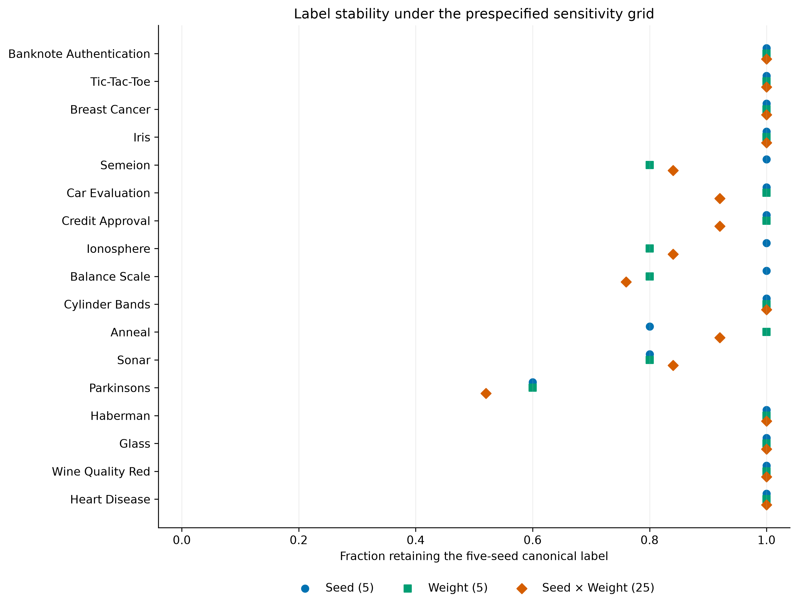
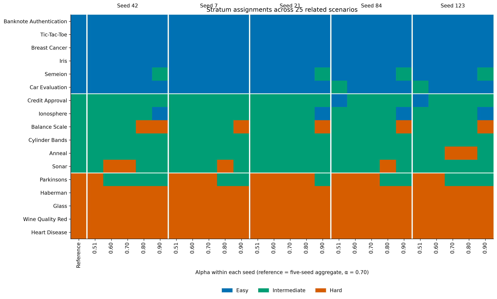
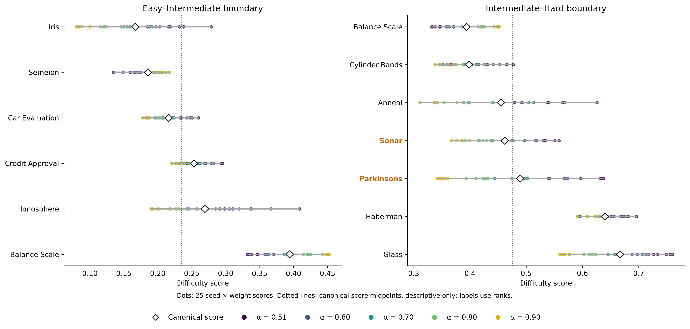
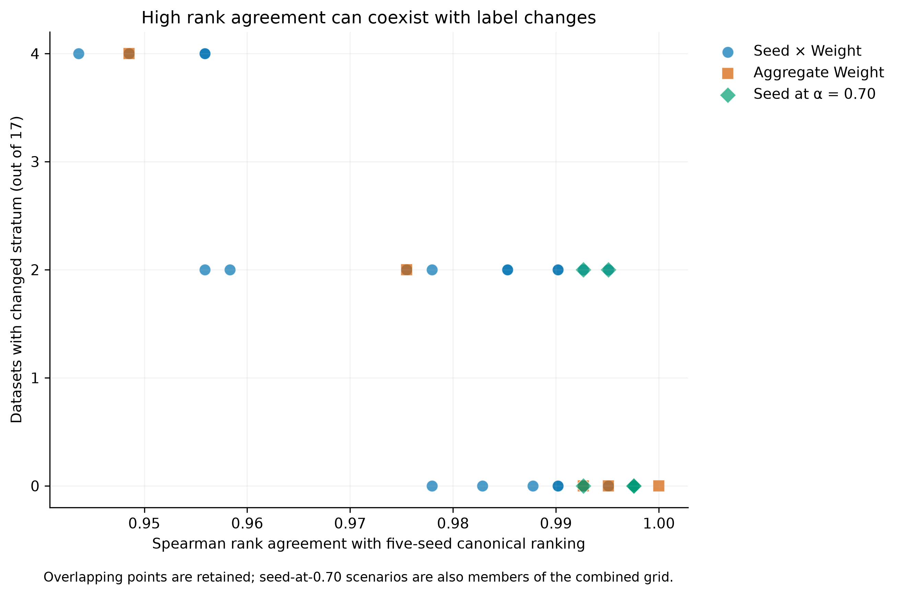

> **Final status — repository review:** This analysis remains complete and unchanged. Block 8 now adds independent-inductor comparisons using primary F and separate historical H sensitivity groups. See EXPERIMENT_INDEX.md.

# Block 5 — Label stability, weight sensitivity and stratum boundaries

## Main findings

Nine datasets retain their five-seed canonical stratum in all 25 seed × weight scenarios; eight change label at least once. Sonar retains its canonical Intermediate label in 21/25 scenarios (84%); Parkinsons retains its canonical Hard label in 13/25 (52%). High rank agreement coexists with these boundary changes: combined-scenario Spearman correlations range from 0.9436 to 0.9975, while individual scenarios change up to 4 of 17 stratum assignments. The canonical ranking itself is unchanged.

## Method and reference

The reference for every label and rank comparison is the original-score five-seed aggregate from Block 3, at alpha 0.70. All 20,400 official successful records were validated with the existing runner/checkpoint infrastructure; the exact 5,100 canonical DT/LR records reconstruct the saved primary and per-seed rankings. Block 4 outputs were checked only for provenance consistency and supply no scoring inputs. SVM, RIPPER, dummies and regularized trees are excluded.

The grid uses seeds [42, 7, 21, 84, 123] and alpha [0.51, 0.60, 0.70, 0.80, 0.90]. Each seed uses its own validated F and mean within-model sample SD (ddof=1). Aggregate weight sensitivity uses the unchanged five-seed F and mean within-seed SD from Block 3. Each component is min-max normalized on the same 17 datasets. The shared original score_profile and assignment functions compute alpha × normalized E + (1 − alpha) × normalized V; alpha 0.70 retains the exact frozen 0.30 coefficient. No score is rounded before ranking. Exact ties use descending original F, ascending V, then dataset name and stable sorting. Every scenario has 6 Easy, 6 Intermediate and 5 Hard datasets.

Seed stability counts matching individual-seed labels at alpha 0.70 out of 5. Weight stability counts matching aggregate labels across 5 alphas, including alpha 0.70 itself. Combined stability counts matching labels across 25 seed × alpha scenarios. These rates use the five-seed canonical label, not the historical seed-42 label. Five seed scenarios are members of the combined grid and are displayed again in the seed summary; they are not extra scenarios. Alpha 0 and 1 ablations are excluded.

## Primary ranking with label stability

| dataset | mean_macro_f1 | normalized_error | normalized_variability | difficulty_score | rank | stratum | seed_matches | seed_stability | weight_matches | weight_stability | combined_matches | combined_stability |
| --- | --- | --- | --- | --- | --- | --- | --- | --- | --- | --- | --- | --- |
| Banknote Authentication | 0.9821 | 0.0000 | 0.0000 | 0.0000 | 1 | easy | 5 | 1.0000 | 5 | 1.0000 | 25 | 1.0000 |
| Tic-Tac-Toe | 0.9534 | 0.0419 | 0.1118 | 0.0629 | 2 | easy | 5 | 1.0000 | 5 | 1.0000 | 25 | 1.0000 |
| Breast Cancer | 0.9472 | 0.0510 | 0.1808 | 0.0899 | 3 | easy | 5 | 1.0000 | 5 | 1.0000 | 25 | 1.0000 |
| Iris | 0.9489 | 0.0485 | 0.4419 | 0.1665 | 4 | easy | 5 | 1.0000 | 5 | 1.0000 | 25 | 1.0000 |
| Semeion | 0.8340 | 0.2161 | 0.1134 | 0.1853 | 5 | easy | 5 | 1.0000 | 4 | 0.8000 | 21 | 0.8400 |
| Car Evaluation | 0.8670 | 0.1680 | 0.3279 | 0.2159 | 6 | easy | 5 | 1.0000 | 5 | 1.0000 | 23 | 0.9200 |
| Credit Approval | 0.8324 | 0.2185 | 0.3346 | 0.2533 | 7 | intermediate | 5 | 1.0000 | 5 | 1.0000 | 23 | 0.9200 |
| Ionosphere | 0.8659 | 0.1696 | 0.5021 | 0.2693 | 8 | intermediate | 5 | 1.0000 | 4 | 0.8000 | 21 | 0.8400 |
| Balance Scale | 0.6554 | 0.4768 | 0.2007 | 0.3939 | 9 | intermediate | 5 | 1.0000 | 4 | 0.8000 | 19 | 0.7600 |
| Cylinder Bands | 0.7512 | 0.3369 | 0.5419 | 0.3984 | 10 | intermediate | 5 | 1.0000 | 5 | 1.0000 | 25 | 1.0000 |
| Anneal | 0.7853 | 0.2872 | 0.8461 | 0.4549 | 11 | intermediate | 4 | 0.8000 | 5 | 1.0000 | 23 | 0.9200 |
| Sonar | 0.7452 | 0.3457 | 0.7325 | 0.4618 | 12 | intermediate | 4 | 0.8000 | 4 | 0.8000 | 21 | 0.8400 |
| Parkinsons | 0.7869 | 0.2849 | 0.9669 | 0.4895 | 13 | hard | 3 | 0.6000 | 3 | 0.6000 | 13 | 0.5200 |
| Haberman | 0.5720 | 0.5984 | 0.7356 | 0.6395 | 14 | hard | 5 | 1.0000 | 5 | 1.0000 | 25 | 1.0000 |
| Glass | 0.6230 | 0.5240 | 1.0000 | 0.6668 | 15 | hard | 5 | 1.0000 | 5 | 1.0000 | 25 | 1.0000 |
| Wine Quality Red | 0.3210 | 0.9647 | 0.3942 | 0.7935 | 16 | hard | 5 | 1.0000 | 5 | 1.0000 | 25 | 1.0000 |
| Heart Disease | 0.2968 | 1.0000 | 0.6986 | 0.9096 | 17 | hard | 5 | 1.0000 | 5 | 1.0000 | 25 | 1.0000 |

For the primary manuscript table, use **combined_stability** as the label-stability column; retain seed and weight stability in supplementary tables. Suggested footnote: “Label stability is the fraction of 25 prespecified scenarios (five CV seeds × five error weights: 0.51, 0.60, 0.70, 0.80, 0.90) retaining the dataset’s original five-seed aggregated canonical stratum at alpha 0.70. This is descriptive agreement on a related sensitivity grid, not a probability of label correctness.”

## Seed stability

| dataset | seed_matches | seed_differences | seed_stability | label_seed_42 | label_seed_7 | label_seed_21 | label_seed_84 | label_seed_123 | most_frequent_seed_labels | canonical_agrees_with_majority |
| --- | --- | --- | --- | --- | --- | --- | --- | --- | --- | --- |
| Banknote Authentication | 5 | 0 | 1.0000 | easy | easy | easy | easy | easy | easy | True |
| Tic-Tac-Toe | 5 | 0 | 1.0000 | easy | easy | easy | easy | easy | easy | True |
| Breast Cancer | 5 | 0 | 1.0000 | easy | easy | easy | easy | easy | easy | True |
| Iris | 5 | 0 | 1.0000 | easy | easy | easy | easy | easy | easy | True |
| Semeion | 5 | 0 | 1.0000 | easy | easy | easy | easy | easy | easy | True |
| Car Evaluation | 5 | 0 | 1.0000 | easy | easy | easy | easy | easy | easy | True |
| Credit Approval | 5 | 0 | 1.0000 | intermediate | intermediate | intermediate | intermediate | intermediate | intermediate | True |
| Ionosphere | 5 | 0 | 1.0000 | intermediate | intermediate | intermediate | intermediate | intermediate | intermediate | True |
| Balance Scale | 5 | 0 | 1.0000 | intermediate | intermediate | intermediate | intermediate | intermediate | intermediate | True |
| Cylinder Bands | 5 | 0 | 1.0000 | intermediate | intermediate | intermediate | intermediate | intermediate | intermediate | True |
| Anneal | 4 | 1 | 0.8000 | intermediate | intermediate | intermediate | intermediate | hard | intermediate | True |
| Sonar | 4 | 1 | 0.8000 | hard | intermediate | intermediate | intermediate | intermediate | intermediate | True |
| Parkinsons | 3 | 2 | 0.6000 | intermediate | hard | hard | hard | intermediate | hard | True |
| Haberman | 5 | 0 | 1.0000 | hard | hard | hard | hard | hard | hard | True |
| Glass | 5 | 0 | 1.0000 | hard | hard | hard | hard | hard | hard | True |
| Wine Quality Red | 5 | 0 | 1.0000 | hard | hard | hard | hard | hard | hard | True |
| Heart Disease | 5 | 0 | 1.0000 | hard | hard | hard | hard | hard | hard | True |

Sonar differs only at seed 42; Anneal differs only at seed 123. Parkinsons differs at seeds 42 and 123. All canonical labels agree with a strict majority of the five individual-seed labels. Modal-label ties, if present, would be listed explicitly; strict majority means more than 2/5.

## Weight stability on five-seed aggregate components

| dataset | weight_matches | weight_stability | label_alpha_0.51 | label_alpha_0.60 | label_alpha_0.70 | label_alpha_0.80 | label_alpha_0.90 | minimum_rank | maximum_rank | minimum_score | maximum_score | changed_alphas |
| --- | --- | --- | --- | --- | --- | --- | --- | --- | --- | --- | --- | --- |
| Banknote Authentication | 5 | 1.0000 | easy | easy | easy | easy | easy | 1 | 1 | 0.0000 | 0.0000 |  |
| Tic-Tac-Toe | 5 | 1.0000 | easy | easy | easy | easy | easy | 2 | 2 | 0.0489 | 0.0761 |  |
| Breast Cancer | 5 | 1.0000 | easy | easy | easy | easy | easy | 3 | 3 | 0.0640 | 0.1146 |  |
| Iris | 5 | 1.0000 | easy | easy | easy | easy | easy | 4 | 5 | 0.0879 | 0.2413 |  |
| Semeion | 4 | 0.8000 | easy | easy | easy | easy | intermediate | 4 | 7 | 0.1658 | 0.2059 | 0.90 |
| Car Evaluation | 5 | 1.0000 | easy | easy | easy | easy | easy | 5 | 6 | 0.1840 | 0.2463 |  |
| Credit Approval | 5 | 1.0000 | intermediate | intermediate | intermediate | intermediate | intermediate | 7 | 8 | 0.2301 | 0.2754 |  |
| Ionosphere | 4 | 0.8000 | intermediate | intermediate | intermediate | intermediate | easy | 6 | 8 | 0.2028 | 0.3325 | 0.90 |
| Balance Scale | 4 | 0.8000 | intermediate | intermediate | intermediate | intermediate | hard | 9 | 13 | 0.3415 | 0.4492 | 0.90 |
| Cylinder Bands | 5 | 1.0000 | intermediate | intermediate | intermediate | intermediate | intermediate | 9 | 11 | 0.3574 | 0.4373 |  |
| Anneal | 5 | 1.0000 | intermediate | intermediate | intermediate | intermediate | intermediate | 9 | 12 | 0.3431 | 0.5611 |  |
| Sonar | 4 | 0.8000 | intermediate | intermediate | intermediate | hard | intermediate | 11 | 13 | 0.3844 | 0.5352 | 0.80 |
| Parkinsons | 3 | 0.6000 | hard | hard | hard | intermediate | intermediate | 10 | 13 | 0.3531 | 0.6191 | 0.80;0.90 |
| Haberman | 5 | 1.0000 | hard | hard | hard | hard | hard | 14 | 15 | 0.6121 | 0.6656 |  |
| Glass | 5 | 1.0000 | hard | hard | hard | hard | hard | 14 | 16 | 0.5716 | 0.7573 |  |
| Wine Quality Red | 5 | 1.0000 | hard | hard | hard | hard | hard | 15 | 16 | 0.6851 | 0.9076 |  |
| Heart Disease | 5 | 1.0000 | hard | hard | hard | hard | hard | 17 | 17 | 0.8523 | 0.9699 |  |

At aggregate alpha 0.80, Sonar and Parkinsons exchange sides of the Intermediate–Hard boundary. At alpha 0.90, Balance Scale and Parkinsons exchange sides of that boundary, while Semeion and Ionosphere exchange sides of the Easy–Intermediate boundary. Alpha 0.51, 0.60 and 0.70 preserve all canonical labels. These are exact sampled alpha values with differing labels, not estimated continuous change thresholds. The five-seed results are not equated with historical seed-42 weight sensitivity.

## Combined stability

| dataset | combined_matches | combined_stability | minimum_rank | maximum_rank | distinct_labels | boundary_crossing_count |
| --- | --- | --- | --- | --- | --- | --- |
| Banknote Authentication | 25 | 1.0000 | 1 | 1 | 1 | 0 |
| Tic-Tac-Toe | 25 | 1.0000 | 2 | 2 | 1 | 0 |
| Breast Cancer | 25 | 1.0000 | 3 | 3 | 1 | 0 |
| Iris | 25 | 1.0000 | 4 | 6 | 1 | 0 |
| Semeion | 21 | 0.8400 | 4 | 7 | 2 | 4 |
| Car Evaluation | 23 | 0.9200 | 5 | 7 | 2 | 2 |
| Credit Approval | 23 | 0.9200 | 6 | 8 | 2 | 2 |
| Ionosphere | 21 | 0.8400 | 6 | 9 | 2 | 4 |
| Balance Scale | 19 | 0.7600 | 8 | 13 | 2 | 6 |
| Cylinder Bands | 25 | 1.0000 | 9 | 11 | 1 | 0 |
| Anneal | 23 | 0.9200 | 9 | 13 | 2 | 2 |
| Sonar | 21 | 0.8400 | 10 | 13 | 2 | 4 |
| Parkinsons | 13 | 0.5200 | 9 | 14 | 2 | 12 |
| Haberman | 25 | 1.0000 | 13 | 15 | 1 | 0 |
| Glass | 25 | 1.0000 | 14 | 16 | 1 | 0 |
| Wine Quality Red | 25 | 1.0000 | 14 | 16 | 1 | 0 |
| Heart Disease | 25 | 1.0000 | 17 | 17 | 1 | 0 |

The eight datasets with at least one label change are Semeion, Car Evaluation, Credit Approval, Ionosphere, Balance Scale, Anneal, Sonar and Parkinsons. Every other dataset retains its label in all 25 scenarios. Every observed label change crosses one adjacent boundary; no dataset spans all three labels. The complete list of differing scenarios is in combined_stability.csv and every differing dataset/scenario record, including its score and ranks, is in label_transition_details.csv.

## Ranking agreement is distinct from label agreement

| family | spearman_rank_min | spearman_rank_mean | spearman_rank_max | kendall_tau_b_min | kendall_tau_b_mean | kendall_tau_b_max | changed_strata_min | changed_strata_mean | changed_strata_max | label_agreement_mean |
| --- | --- | --- | --- | --- | --- | --- | --- | --- | --- | --- |
| aggregate_weight | 0.9485 | 0.9824 | 1.0000 | 0.8382 | 0.9353 | 1.0000 | 0 | 1.2000 | 4 | 0.9294 |
| combined | 0.9436 | 0.9805 | 0.9975 | 0.8235 | 0.9253 | 0.9853 | 0 | 1.4400 | 4 | 0.9153 |
| seed | 0.9926 | 0.9951 | 0.9975 | 0.9559 | 0.9735 | 0.9853 | 0 | 0.8000 | 2 | 0.9529 |

The per-scenario CSV additionally reports mean/max absolute rank displacement and changed-rank counts. Seed-only correlations range from 0.9926 to 0.9975, despite two seeds changing two labels each. Aggregate weight correlations range from 0.9485 to 1.0000; combined correlations range from 0.9436 to 0.9975. Rank correlations summarize all 17 positions, while moving one position across rank 6/7 or 12/13 changes a label. High correlation therefore does not guarantee stable boundary membership.

## Boundary analysis

| boundary | lower_rank | upper_rank | easier_dataset | harder_dataset | easier_score | harder_score | score_gap | descriptive_midpoint |
| --- | --- | --- | --- | --- | --- | --- | --- | --- |
| Easy–Intermediate | 6 | 7 | Car Evaluation | Credit Approval | 0.2159 | 0.2533 | 0.0374 | 0.2346 |
| Intermediate–Hard | 12 | 13 | Sonar | Parkinsons | 0.4618 | 0.4895 | 0.0278 | 0.4756 |

The canonical Easy–Intermediate score gap is 0.037363 (Car Evaluation rank 6 versus Credit Approval rank 7). The Intermediate–Hard gap is 0.027756 (Sonar rank 12 versus Parkinsons rank 13). Midpoints shown in figures are descriptive aids only; labels are always assigned by sorted ranks, never by score thresholds.

| dataset | rank | difficulty_score | stratum | seed_stability | weight_stability | combined_stability | minimum_rank | maximum_rank | boundary_crossing_count | easy_intermediate_crossings | intermediate_hard_crossings | aggregate_weight_boundary_crossing_count |
| --- | --- | --- | --- | --- | --- | --- | --- | --- | --- | --- | --- | --- |
| Semeion | 5 | 0.1853 | easy | 1.0000 | 0.8000 | 0.8400 | 4 | 7 | 4 | 4 | 0 | 1 |
| Car Evaluation | 6 | 0.2159 | easy | 1.0000 | 1.0000 | 0.9200 | 5 | 7 | 2 | 2 | 0 | 0 |
| Credit Approval | 7 | 0.2533 | intermediate | 1.0000 | 1.0000 | 0.9200 | 6 | 8 | 2 | 2 | 0 | 0 |
| Ionosphere | 8 | 0.2693 | intermediate | 1.0000 | 0.8000 | 0.8400 | 6 | 9 | 4 | 4 | 0 | 1 |
| Balance Scale | 9 | 0.3939 | intermediate | 1.0000 | 0.8000 | 0.7600 | 8 | 13 | 6 | 0 | 6 | 1 |
| Anneal | 11 | 0.4549 | intermediate | 0.8000 | 1.0000 | 0.9200 | 9 | 13 | 2 | 0 | 2 | 0 |
| Sonar | 12 | 0.4618 | intermediate | 0.8000 | 0.8000 | 0.8400 | 10 | 13 | 4 | 0 | 4 | 1 |
| Parkinsons | 13 | 0.4895 | hard | 0.6000 | 0.6000 | 0.5200 | 9 | 14 | 12 | 0 | 12 | 2 |
| Haberman | 14 | 0.6395 | hard | 1.0000 | 1.0000 | 1.0000 | 13 | 15 | 0 | 0 | 0 | 0 |

Boundary-crossing counts count differences from the canonical side per boundary per scenario, not sequential transitions between arbitrarily ordered grid columns. The main boundary_crossing_count covers the 25 combined scenarios; aggregate weight crossings are reported separately. The following table lists the sets exchanging membership across each fixed boundary in each scenario. These are membership exchanges, not a claim of paired causal interactions.

| boundary | scenario | family | seed | alpha | moved_to_harder_side | moved_to_easier_side | count_each_direction |
| --- | --- | --- | --- | --- | --- | --- | --- |
| Easy–Intermediate | seed_42_alpha_0.90 | combined | 42.0000 | 0.9000 | semeion | ionosphere | 1 |
| Easy–Intermediate | seed_21_alpha_0.90 | combined | 21.0000 | 0.9000 | semeion | ionosphere | 1 |
| Easy–Intermediate | seed_84_alpha_0.51 | combined | 84.0000 | 0.5100 | car | credit_approval | 1 |
| Easy–Intermediate | seed_84_alpha_0.90 | combined | 84.0000 | 0.9000 | semeion | ionosphere | 1 |
| Easy–Intermediate | seed_123_alpha_0.51 | combined | 123.0000 | 0.5100 | car | credit_approval | 1 |
| Easy–Intermediate | seed_123_alpha_0.90 | combined | 123.0000 | 0.9000 | semeion | ionosphere | 1 |
| Easy–Intermediate | aggregate_alpha_0.90 | aggregate_weight |  | 0.9000 | semeion | ionosphere | 1 |
| Intermediate–Hard | seed_42_alpha_0.60 | combined | 42.0000 | 0.6000 | sonar | parkinsons | 1 |
| Intermediate–Hard | seed_42_alpha_0.70 | combined | 42.0000 | 0.7000 | sonar | parkinsons | 1 |
| Intermediate–Hard | seed_42_alpha_0.80 | combined | 42.0000 | 0.8000 | balance_scale | parkinsons | 1 |
| Intermediate–Hard | seed_42_alpha_0.90 | combined | 42.0000 | 0.9000 | balance_scale | parkinsons | 1 |
| Intermediate–Hard | seed_7_alpha_0.80 | combined | 7.0000 | 0.8000 | sonar | parkinsons | 1 |
| Intermediate–Hard | seed_7_alpha_0.90 | combined | 7.0000 | 0.9000 | balance_scale | parkinsons | 1 |
| Intermediate–Hard | seed_21_alpha_0.90 | combined | 21.0000 | 0.9000 | balance_scale | parkinsons | 1 |
| Intermediate–Hard | seed_84_alpha_0.80 | combined | 84.0000 | 0.8000 | sonar | parkinsons | 1 |
| Intermediate–Hard | seed_84_alpha_0.90 | combined | 84.0000 | 0.9000 | balance_scale | parkinsons | 1 |
| Intermediate–Hard | seed_123_alpha_0.70 | combined | 123.0000 | 0.7000 | anneal | parkinsons | 1 |
| Intermediate–Hard | seed_123_alpha_0.80 | combined | 123.0000 | 0.8000 | anneal | parkinsons | 1 |
| Intermediate–Hard | seed_123_alpha_0.90 | combined | 123.0000 | 0.9000 | balance_scale | parkinsons | 1 |
| Intermediate–Hard | aggregate_alpha_0.80 | aggregate_weight |  | 0.8000 | sonar | parkinsons | 1 |
| Intermediate–Hard | aggregate_alpha_0.90 | aggregate_weight |  | 0.9000 | balance_scale | parkinsons | 1 |

### Sonar and Parkinsons

Sonar’s primary label is Intermediate, rank 12, score 0.461755. It retains this label in 4/5 seeds, 4/5 aggregate alpha values and 21/25 combined scenarios. It becomes Hard at seed 42 with alpha 0.60 and 0.70, and at seeds 7 and 84 with alpha 0.80. On aggregate components, alpha 0.80 changes Sonar to Hard; alpha 0.90 returns it to Intermediate. Stability is therefore not necessarily monotonic in alpha.

Parkinsons’ primary label is Hard, rank 13, score 0.489511. It retains Hard in 3/5 seeds, 3/5 aggregate alpha values and 13/25 combined scenarios. Its 12 combined departures are to Intermediate and exchange boundary membership with Sonar, Balance Scale or Anneal depending on the scenario. Its canonical label still agrees with the majority of individual-seed labels at alpha 0.70; the lower combined rate reflects additional weight sensitivity. Neither rate is a probability of the label being correct.

### Both boundaries and other requested datasets

At the Easy–Intermediate boundary, Car Evaluation and Credit Approval exchange membership for seeds 84 and 123 at alpha 0.51. Semeion and Ionosphere exchange membership at alpha 0.90 for seeds 42, 21, 84 and 123. At the Intermediate–Hard boundary, Anneal becomes Hard for seed 123 at alpha 0.70 and 0.80, paired with Parkinsons moving to Intermediate. Balance Scale becomes Hard at alpha 0.90 for every seed, and also at seed 42 / alpha 0.80. Haberman remains Hard throughout. All scenarios and rank ranges are provided in the tables.

## Publication figures and exports

A. Three agreement rates by canonical rank.



[Vector PDF](analysis/block5-label-stability-v1/label_stability.pdf)

B. Canonical reference and 25 seed × weight label assignments.



[Vector PDF](analysis/block5-label-stability-v1/scenario_heatmap.pdf)

C. Scores around both fixed rank boundaries; Sonar and Parkinsons highlighted.



[Vector PDF](analysis/block5-label-stability-v1/boundary_sensitivity.pdf)

D. Rank agreement versus the number of changed labels.



[Vector PDF](analysis/block5-label-stability-v1/rank_vs_label_agreement.pdf)

Exports under `analysis/block5-label-stability-v1/`: `boundary_analysis.csv`, `boundary_exchanges.csv`, `canonical_boundary_gaps.csv`, `canonical_ranking_with_stability.csv`, `combined_stability.csv`, `label_transition_details.csv`, `rank_agreement_by_family.csv`, `rank_agreement_summary.csv`, `scenario_rankings.csv`, `seed_stability.csv`, `weight_stability.csv`. PNG figures use 300 dpi, PDFs are vector; CSVs retain round-trip precision. Provenance and official/artifact checksums accompany the tables.

## Reproduction and validation

```powershell
.venv/Scripts/python.exe -m unittest experiments.protocol.test_block3 experiments.protocol.test_block4 experiments.protocol.test_block5
.venv/Scripts/python.exe -m experiments.protocol.block5_analysis --output experiments/analysis/block5-label-stability-reproduction
```

Existing output directories are refused. The appended Block 5 notebook section reads checksummed saved exports and never runs evaluations. Run only these new display cells; historical cells may contain training workflows. All previous notebook cells are preserved.

Automated checks verify exact Block 3 primary/per-seed reconstruction, canonical model identities, seed aggregation, alpha values and weights, per-seed and aggregate normalization, 6/6/5 scenario strata, denominators 5/5/25, canonical reference use, 30 distinct scenarios (25 combined + 5 aggregate) and 510 dataset/scenario rows, deterministic exact ties, absence of pre-ranking rounding, invalid-reference rejection and exclusion of chance correction. Source checks prohibit model fitting and split-generation calls in the analysis. Protected Block 3/4 exports, historical outputs, frozen configuration, saved splits, official records and prior notebook cells are checksum-audited; see `protocol/block5_validation_report.json` for final audit counts.

Final verification: 19 analysis tests passed (Blocks 3–5); 20,400 official record files and 4,877 protected files remain byte-identical. All 40 prior notebook cells and notebook metadata are unchanged; eight cells were appended and only four new display cells executed. All 70 code cells across the three notebooks parse, notebook structure validates, and the environment identity is unchanged. Exported stability values match an exact independent recomputation from the validated Block 3 components. No models were fitted and no CV partitions were generated.

## Reviewer traceability and suggested abstract wording

**R1.2b:** the primary table includes seed, weight and combined stability with explicit denominators; the recommended combined-stability column and footnote define the reference label and sensitivity grid. Full scenario rankings, labels and transitions accompany it.

**R1.2c:** exact evidence for an abstract acknowledgment includes Sonar’s 21/25 Intermediate agreements and Parkinsons’ 13/25 Hard agreements, plus up to four changed assignments per combined scenario despite Spearman correlations at least 0.9436. Suggested sentence:

> Across the prespecified seed–weight sensitivity grid, rank correlations remained high (Spearman 0.944–0.998), but boundary membership changed: Sonar and Parkinsons retained their five-seed canonical strata in 84% and 52% of scenarios, respectively.

This is proposed wording only; the manuscript and abstract were not edited.

## Limitations

The 25 scenarios share data, folds and score components and vary weights systematically. They are not independent experimental replicates; no binomial intervals, inferential p-values or probability-of-correctness claims are appropriate. The reported rates depend on the selected alpha grid, the 17-dataset pool, fixed stratum sizes, four baseline learners, metric and canonical reference. The inclusion of alpha 0.70 guarantees one matching aggregate weight configuration. Min-max normalization is relative to this pool, and score ranges across differently normalized seeds are descriptive. Labels compress a continuous relative ordering and are especially sensitive near rank cut points. Historical seed-42 comparisons and chance correction remain separate analyses. No score, pool, hyperparameter, environment or canonical label was changed.
