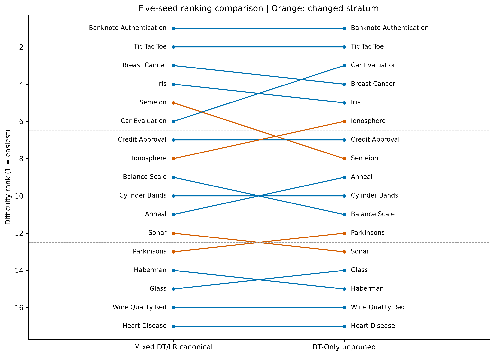
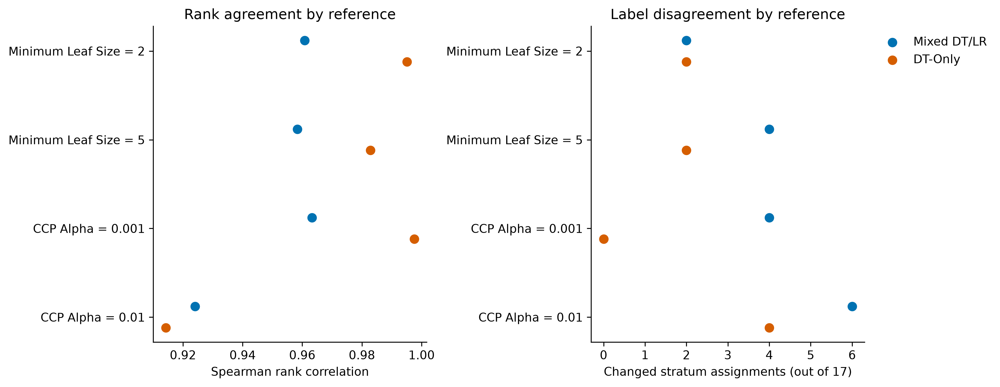
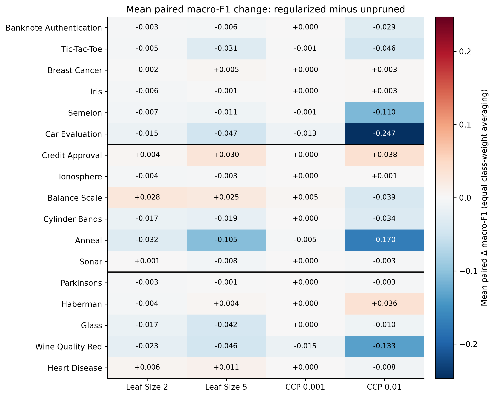
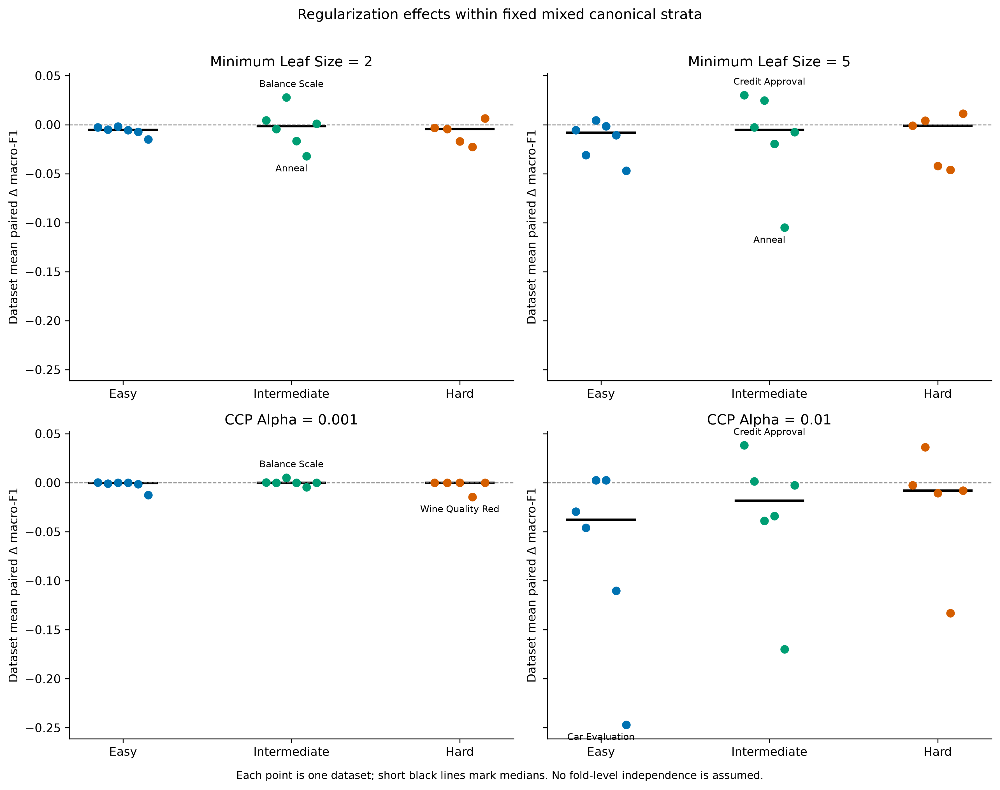
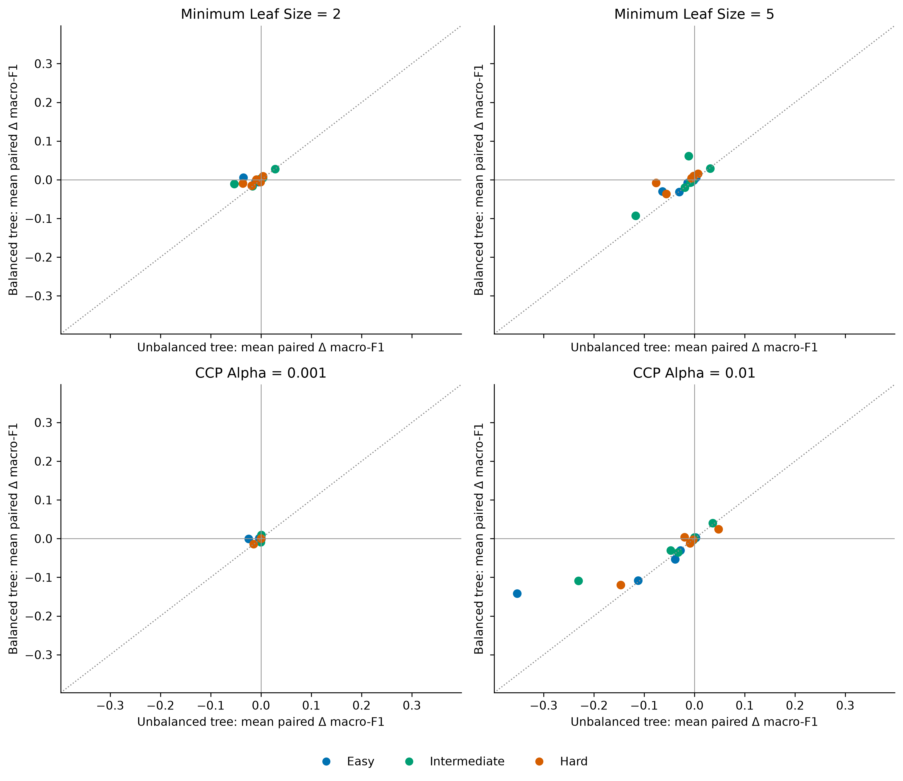

> **Final status — repository review:** The independent-inductor evaluation previously reserved for Block 8 is complete; see BLOCK8_OPTIMAL_TREES.md. This report’s original F-based summaries and scientific values are unchanged.

# Block 6 — DT-only characterization and tree regularization

## Findings

Five-seed DT-only characterization changes 11 of 17 ranks and four strata (23.53%) relative to the mixed DT/LR canonical reference. Spearman agreement is 0.9559 and Kendall tau-b is 0.8382. Semeion moves Easy→Intermediate, Ionosphere Intermediate→Easy, Sonar Intermediate→Hard and Parkinsons Hard→Intermediate. The canonical ranking is preserved; no preferred baseline pool or regularization panel is selected.

All 10,200 required regularized-versus-unpruned fold pairs passed exact provenance matching. Across datasets within the canonical Hard stratum, the mean effect is negative under every panel. Individual gains coexist with losses, and the sign of some stratum means changes when one or two influential datasets are removed. These results support a descriptive use of strata to organize heterogeneous behavior, not a claim that Hard membership predicts regularization gains.

## Protocol and aggregation

The official run contains 20,400 validated successful evaluations. The analysis selects 12,750 tree records (17 datasets × 10 tree configurations × 75 folds), plus the canonical LR records for the diagnostic. Each model mean and sample SD is first calculated within each seed’s 15 evaluations; the five means and within-seed SDs are then averaged. Each DT panel equally weights its unbalanced and balanced trees. The original score uses E=1−F and the mean within-seed variability V, independent min-max normalization of E and V across the fixed 17 datasets, and exactly 0.70/0.30 weights. Ranking reuses the frozen exact-score, descending-F, ascending-V, dataset-name tie-breaking and 6/6/5 strata.

The primary reference is the Block 3 five-seed mixed characterization, reconstructed exactly from validated folds. Blocks 4 and 5 are checked for artifact integrity; chance-corrected labels never enter this analysis. The four frozen panels are minimum leaf sizes 2 and 5, and cost-complexity alpha 0.001 and 0.01. No hyperparameters were tuned or selected for ranking agreement.

## Full DT-only ranking

| dataset | variant | mean_macro_f1 | error | variability | normalized_error | normalized_variability | difficulty_score | rank | stratum |
| --- | --- | --- | --- | --- | --- | --- | --- | --- | --- |
| Banknote Authentication | dt_only | 0.9830 | 0.0170 | 0.0070 | 0.0000 | 0.0000 | 0.0000 | 1 | easy |
| Tic-Tac-Toe | dt_only | 0.9288 | 0.0712 | 0.0203 | 0.0767 | 0.1727 | 0.1055 | 2 | easy |
| Car Evaluation | dt_only | 0.9351 | 0.0649 | 0.0276 | 0.0678 | 0.2676 | 0.1277 | 3 | easy |
| Breast Cancer | dt_only | 0.9208 | 0.0792 | 0.0250 | 0.0880 | 0.2330 | 0.1315 | 4 | easy |
| Iris | dt_only | 0.9432 | 0.0568 | 0.0387 | 0.0563 | 0.4104 | 0.1625 | 5 | easy |
| Ionosphere | dt_only | 0.8679 | 0.1321 | 0.0467 | 0.1629 | 0.5143 | 0.2683 | 6 | easy |
| Credit Approval | dt_only | 0.8053 | 0.1947 | 0.0345 | 0.2515 | 0.3562 | 0.2829 | 7 | intermediate |
| Semeion | dt_only | 0.7458 | 0.2542 | 0.0198 | 0.3357 | 0.1655 | 0.2847 | 8 | intermediate |
| Anneal | dt_only | 0.8802 | 0.1198 | 0.0686 | 0.1455 | 0.7979 | 0.3412 | 9 | intermediate |
| Cylinder Bands | dt_only | 0.7496 | 0.2504 | 0.0465 | 0.3304 | 0.5116 | 0.3848 | 10 | intermediate |
| Balance Scale | dt_only | 0.5799 | 0.4201 | 0.0185 | 0.5705 | 0.1486 | 0.4439 | 11 | intermediate |
| Parkinsons | dt_only | 0.8074 | 0.1926 | 0.0775 | 0.2486 | 0.9134 | 0.4480 | 12 | intermediate |
| Sonar | dt_only | 0.7187 | 0.2813 | 0.0616 | 0.3740 | 0.7075 | 0.4741 | 13 | hard |
| Glass | dt_only | 0.6499 | 0.3501 | 0.0842 | 0.4714 | 1.0000 | 0.6300 | 14 | hard |
| Haberman | dt_only | 0.5549 | 0.4451 | 0.0603 | 0.6060 | 0.6897 | 0.6311 | 15 | hard |
| Wine Quality Red | dt_only | 0.3570 | 0.6430 | 0.0402 | 0.8861 | 0.4298 | 0.7492 | 16 | hard |
| Heart Disease | dt_only | 0.2765 | 0.7235 | 0.0536 | 1.0000 | 0.6031 | 0.8809 | 17 | hard |

## Canonical and DT-only assignments side by side (R1.3b)

| dataset | difficulty_score | rank | stratum | dt_only_difficulty | dt_only_rank | dt_only_stratum |
| --- | --- | --- | --- | --- | --- | --- |
| Banknote Authentication | 0.0000 | 1 | easy | 0.0000 | 1 | easy |
| Tic-Tac-Toe | 0.0629 | 2 | easy | 0.1055 | 2 | easy |
| Breast Cancer | 0.0899 | 3 | easy | 0.1315 | 4 | easy |
| Iris | 0.1665 | 4 | easy | 0.1625 | 5 | easy |
| Semeion | 0.1853 | 5 | easy | 0.2847 | 8 | intermediate |
| Car Evaluation | 0.2159 | 6 | easy | 0.1277 | 3 | easy |
| Credit Approval | 0.2533 | 7 | intermediate | 0.2829 | 7 | intermediate |
| Ionosphere | 0.2693 | 8 | intermediate | 0.2683 | 6 | easy |
| Balance Scale | 0.3939 | 9 | intermediate | 0.4439 | 11 | intermediate |
| Cylinder Bands | 0.3984 | 10 | intermediate | 0.3848 | 10 | intermediate |
| Anneal | 0.4549 | 11 | intermediate | 0.3412 | 9 | intermediate |
| Sonar | 0.4618 | 12 | intermediate | 0.4741 | 13 | hard |
| Parkinsons | 0.4895 | 13 | hard | 0.4480 | 12 | intermediate |
| Haberman | 0.6395 | 14 | hard | 0.6311 | 15 | hard |
| Glass | 0.6668 | 15 | hard | 0.6300 | 14 | hard |
| Wine Quality Red | 0.7935 | 16 | hard | 0.7492 | 16 | hard |
| Heart Disease | 0.9096 | 17 | hard | 0.8809 | 17 | hard |

| comparison | spearman_rank | kendall_tau_b | changed_ranks | changed_strata | changed_strata_percent | mean_absolute_rank_displacement | maximum_absolute_rank_displacement | boundary_crossers | easy_intermediate_crossers | intermediate_hard_crossers |
| --- | --- | --- | --- | --- | --- | --- | --- | --- | --- | --- |
| mixed_vs_dt_only | 0.9559 | 0.8382 | 11 | 4 | 23.5294 | 1.0588 | 3 | semeion;ionosphere;sonar;parkinsons | semeion;ionosphere | sonar;parkinsons |

Mean absolute rank displacement is 1.0588; the maximum is 3. The Easy–Intermediate membership exchange is Semeion versus Ionosphere, and the Intermediate–Hard exchange is Sonar versus Parkinsons. Full component/score differences and rank/label transitions are in mixed_vs_dt_only.csv. The side-by-side table is a new export and does not overwrite the canonical table.

## DT versus LR performance diagnostic (R1.3a)

| dataset | mean_macro_f1_dt | variability_dt | mean_macro_f1_lr | variability_lr | dt_minus_lr_macro_f1 | rank_reference | rank_alternative | stratum_reference | stratum_alternative | stratum_changed |
| --- | --- | --- | --- | --- | --- | --- | --- | --- | --- | --- |
| Banknote Authentication | 0.9830 | 0.0070 | 0.9812 | 0.0072 | 0.0018 | 1 | 1 | easy | easy | False |
| Tic-Tac-Toe | 0.9288 | 0.0203 | 0.9780 | 0.0100 | -0.0492 | 2 | 2 | easy | easy | False |
| Car Evaluation | 0.9351 | 0.0276 | 0.7989 | 0.0340 | 0.1362 | 6 | 3 | easy | easy | False |
| Breast Cancer | 0.9208 | 0.0250 | 0.9736 | 0.0153 | -0.0528 | 3 | 4 | easy | easy | False |
| Iris | 0.9432 | 0.0387 | 0.9545 | 0.0394 | -0.0112 | 4 | 5 | easy | easy | False |
| Ionosphere | 0.8679 | 0.0467 | 0.8640 | 0.0401 | 0.0039 | 8 | 6 | intermediate | easy | True |
| Credit Approval | 0.8053 | 0.0345 | 0.8595 | 0.0281 | -0.0542 | 7 | 7 | intermediate | intermediate | False |
| Semeion | 0.7458 | 0.0198 | 0.9222 | 0.0108 | -0.1764 | 5 | 8 | easy | intermediate | True |
| Anneal | 0.8802 | 0.0686 | 0.6904 | 0.0680 | 0.1899 | 11 | 9 | intermediate | intermediate | False |
| Cylinder Bands | 0.7496 | 0.0465 | 0.7529 | 0.0461 | -0.0033 | 10 | 10 | intermediate | intermediate | False |
| Balance Scale | 0.5799 | 0.0185 | 0.7308 | 0.0247 | -0.1509 | 9 | 11 | intermediate | intermediate | False |
| Parkinsons | 0.8074 | 0.0775 | 0.7663 | 0.0765 | 0.0410 | 13 | 12 | hard | intermediate | True |
| Sonar | 0.7187 | 0.0616 | 0.7716 | 0.0585 | -0.0529 | 12 | 13 | intermediate | hard | True |
| Glass | 0.6499 | 0.0842 | 0.5960 | 0.0747 | 0.0539 | 15 | 14 | hard | hard | False |
| Haberman | 0.5549 | 0.0603 | 0.5892 | 0.0603 | -0.0344 | 14 | 15 | hard | hard | False |
| Wine Quality Red | 0.3570 | 0.0402 | 0.2850 | 0.0310 | 0.0720 | 16 | 16 | hard | hard | False |
| Heart Disease | 0.2765 | 0.0536 | 0.3171 | 0.0617 | -0.0406 | 17 | 17 | hard | hard | False |

Semeion has substantially lower DT mean macro-F1 than LR (0.7458 versus 0.9222; difference −0.1764), consistent with its move from Easy to Intermediate when LR is removed. Sonar’s DT mean is also lower (0.7187 versus 0.7716; −0.0529), while Parkinsons has higher DT performance (0.8074 versus 0.7663; +0.0410). Ionosphere crosses into Easy despite only a small DT–LR performance difference (+0.0039): assignments are relative and also depend on variability, normalization endpoints and other datasets’ movements. Anneal (+0.1899), Car Evaluation (+0.1362), and Balance Scale (−0.1509) further illustrate learner-dependent performance even where labels do not change.

The mixed pool can be described as a characterization relative to two distinct inductive biases, reducing exclusive dependence on a single learner family. It is not learner-independent difficulty. DT-only characterization is more directly specific to these two CART configurations but remains model-dependent. These are methodological interpretations, not evidence selecting one pool: DT already contributes half of the mixed score, so their agreement is not independent validation.

## Ranking sensitivity to regularization

| panel | reference | spearman_rank | kendall_tau_b | changed_ranks | changed_strata | changed_strata_percent | mean_absolute_rank_displacement | maximum_absolute_rank_displacement | easy_intermediate_crossers | intermediate_hard_crossers |
| --- | --- | --- | --- | --- | --- | --- | --- | --- | --- | --- |
| Minimum Leaf Size = 2 | mixed | 0.9608 | 0.8676 | 7 | 2 | 11.7647 | 0.8235 | 3 | semeion;ionosphere |  |
| Minimum Leaf Size = 5 | mixed | 0.9583 | 0.8676 | 12 | 4 | 23.5294 | 1.0588 | 3 | semeion;credit_approval | sonar;parkinsons |
| CCP Alpha = 0.001 | mixed | 0.9632 | 0.8529 | 10 | 4 | 23.5294 | 0.9412 | 3 | semeion;ionosphere | sonar;parkinsons |
| CCP Alpha = 0.01 | mixed | 0.9240 | 0.8088 | 11 | 6 | 35.2941 | 1.4118 | 4 | semeion;car;credit_approval;ionosphere | balance_scale;parkinsons |
| Minimum Leaf Size = 2 | dt_only | 0.9951 | 0.9706 | 4 | 2 | 11.7647 | 0.2353 | 1 |  | parkinsons;sonar |
| Minimum Leaf Size = 5 | dt_only | 0.9828 | 0.9118 | 11 | 2 | 11.7647 | 0.7059 | 2 | ionosphere;credit_approval |  |
| CCP Alpha = 0.001 | dt_only | 0.9975 | 0.9853 | 2 | 0 | 0.0000 | 0.1176 | 1 |  |  |
| CCP Alpha = 0.01 | dt_only | 0.9142 | 0.7941 | 12 | 4 | 23.5294 | 1.4118 | 6 | car;credit_approval | balance_scale;sonar |

Each panel is compared with both mixed and unpruned DT-only references. The full 68-row panel ranking table and all 136 dataset/reference transition rows are exported. Mild CCP regularization changes no DT-only stratum assignments, but this is not a criterion for choosing it. Stronger CCP regularization changes six mixed-reference assignments and four DT-only-reference assignments.

## Paired performance differences

Every delta is constructed before aggregation as regularized macro-F1 minus unpruned macro-F1. Pairing keys are dataset identity and fingerprint, seed, repetition, fold, exact saved split ID, environment, protocol and official purpose, with the same class-weight setting. Both configuration IDs, model names and evaluation IDs are retained. Missing, duplicate or inconsistent pairs stop the analysis. There are 75 pairs per dataset/configuration, 150 per dataset/panel and 10,200 overall.

Dataset means equally average the five seed means and the two class-weight configurations. Median, sample SD, min/max and exact positive/negative/zero fold fractions describe the 150 paired values; separate 75-value class-weight summaries and 30-value combined seed summaries are exported. Pooled SD describes dispersion, not uncertainty of an independent-replicate estimate. Mean within-seed SD and SD/range of seed means are also provided. Dataset-level “approximately unchanged” means |mean delta|≤1e-12, a numerical-zero tolerance rather than a practical equivalence margin; fold signs use exact zero.

| dataset | CCP Alpha = 0.001 | CCP Alpha = 0.01 | Minimum Leaf Size = 2 | Minimum Leaf Size = 5 |
| --- | --- | --- | --- | --- |
| Banknote Authentication | 0.0003 | -0.0294 | -0.0026 | -0.0057 |
| Tic-Tac-Toe | -0.0008 | -0.0459 | -0.0048 | -0.0309 |
| Breast Cancer | 0.0000 | 0.0026 | -0.0019 | 0.0045 |
| Iris | 0.0000 | 0.0026 | -0.0056 | -0.0015 |
| Semeion | -0.0014 | -0.1103 | -0.0072 | -0.0107 |
| Car Evaluation | -0.0126 | -0.2470 | -0.0149 | -0.0470 |
| Credit Approval | 0.0003 | 0.0382 | 0.0044 | 0.0302 |
| Ionosphere | 0.0000 | 0.0014 | -0.0044 | -0.0026 |
| Balance Scale | 0.0051 | -0.0387 | 0.0277 | 0.0248 |
| Cylinder Bands | 0.0000 | -0.0339 | -0.0166 | -0.0195 |
| Anneal | -0.0046 | -0.1699 | -0.0322 | -0.1051 |
| Sonar | 0.0000 | -0.0026 | 0.0012 | -0.0076 |
| Parkinsons | 0.0000 | -0.0026 | -0.0032 | -0.0010 |
| Haberman | 0.0000 | 0.0364 | -0.0044 | 0.0041 |
| Glass | 0.0000 | -0.0104 | -0.0171 | -0.0421 |
| Wine Quality Red | -0.0145 | -0.1332 | -0.0227 | -0.0460 |
| Heart Disease | 0.0000 | -0.0079 | 0.0064 | 0.0113 |

## Stratum-level effects (R1.4a)

Labels are always the original mixed canonical strata, not panel-specific labels. Every dataset has equal weight; dataset size and fold counts do not weight these summaries. Each stratum contains 6, 6 or 5 datasets. No new significance tests or fold-based confidence intervals are computed.

| panel | class_weight | canonical_stratum | datasets | mean_dataset_delta | median_dataset_delta | sd_across_datasets | minimum_dataset_delta | maximum_dataset_delta | positive_datasets | negative_datasets | approximately_unchanged_datasets |
| --- | --- | --- | --- | --- | --- | --- | --- | --- | --- | --- | --- |
| Minimum Leaf Size = 2 | both | intermediate | 6 | -0.0033 | -0.0016 | 0.0203 | -0.0322 | 0.0277 | 3 | 3 | 0 |
| Minimum Leaf Size = 2 | both | easy | 6 | -0.0062 | -0.0052 | 0.0047 | -0.0149 | -0.0019 | 0 | 6 | 0 |
| Minimum Leaf Size = 2 | both | hard | 5 | -0.0082 | -0.0044 | 0.0117 | -0.0227 | 0.0064 | 1 | 4 | 0 |
| Minimum Leaf Size = 5 | both | intermediate | 6 | -0.0133 | -0.0051 | 0.0489 | -0.1051 | 0.0302 | 2 | 4 | 0 |
| Minimum Leaf Size = 5 | both | easy | 6 | -0.0152 | -0.0082 | 0.0197 | -0.0470 | 0.0045 | 1 | 5 | 0 |
| Minimum Leaf Size = 5 | both | hard | 5 | -0.0147 | -0.0010 | 0.0271 | -0.0460 | 0.0113 | 2 | 3 | 0 |
| CCP Alpha = 0.001 | both | intermediate | 6 | 0.0001 | 0.0000 | 0.0031 | -0.0046 | 0.0051 | 2 | 1 | 3 |
| CCP Alpha = 0.001 | both | easy | 6 | -0.0024 | -0.0004 | 0.0050 | -0.0126 | 0.0003 | 1 | 3 | 2 |
| CCP Alpha = 0.001 | both | hard | 5 | -0.0029 | 0.0000 | 0.0065 | -0.0145 | 0.0000 | 0 | 1 | 4 |
| CCP Alpha = 0.01 | both | intermediate | 6 | -0.0343 | -0.0183 | 0.0720 | -0.1699 | 0.0382 | 2 | 4 | 0 |
| CCP Alpha = 0.01 | both | easy | 6 | -0.0712 | -0.0376 | 0.0956 | -0.2470 | 0.0026 | 2 | 4 | 0 |
| CCP Alpha = 0.01 | both | hard | 5 | -0.0235 | -0.0079 | 0.0642 | -0.1332 | 0.0364 | 1 | 4 | 0 |

### Findings by panel and deviations from simple patterns

**Minimum Leaf Size = 2**

Easy datasets all lose performance (mean −0.00617). Hard datasets have one gain and four losses (mean −0.00819); Heart Disease gains 0.00643, while Wine Quality Red loses 0.02271. Intermediate effects split three gains/three losses, with Balance Scale +0.02775 and Anneal −0.03215. Removing Anneal changes the Intermediate mean from −0.00329 to +0.00248.

**Minimum Leaf Size = 5**

Easy and Hard means are −0.01522 and −0.01474. Hard gains occur for Heart Disease (+0.01126) and Haberman (+0.00415), while Glass (−0.04208) and Wine Quality Red (−0.04602) lose most. Intermediate gains for Credit Approval (+0.03016) and Balance Scale (+0.02484) coexist with Anneal −0.10506. Removing Anneal changes the Intermediate mean from −0.01330 to +0.00505; removing Glass and Wine Quality Red changes the Hard mean to +0.00480.

**CCP Alpha = 0.001**

Many effects are exactly zero. Intermediate mean +0.000127 is small and sign-sensitive to dataset exclusion. Four of five Hard datasets have zero mean change; the Hard mean −0.002906 is entirely driven by Wine Quality Red (−0.014532). Removing Car Evaluation changes the Easy mean from −0.002411 to −0.000381. This panel provides little evidence of broad stratum-specific benefit.

**CCP Alpha = 0.01**

Mean loss is largest in Easy (−0.07122), followed by Intermediate (−0.03426) and Hard (−0.02354), but means conceal substantial heterogeneity. Car Evaluation loses 0.24699, Semeion loses 0.11025, Anneal loses 0.16987 and Wine Quality Red loses 0.13318. Credit Approval gains 0.03816 and Haberman gains 0.03640. Removing Wine Quality Red turns the Hard mean positive (+0.00387); removing Car Evaluation leaves the Easy mean negative (−0.03606). Removing Anneal and Balance Scale turns the Intermediate mean slightly positive (+0.00075).

The proposed “helps Hard / costs little on Easy” pattern is not generally supported. Mild leaf constraints produce small average Easy losses, but strong pruning has substantial costs on some Easy datasets. Intermediate effects are heterogeneous, yet heterogeneity also occurs in Hard and Easy. It would be misleading to attribute observed effects causally to difficulty labels or to generalize these signs to unseen learners or datasets.

### Influence and continuous-score diagnostics

| panel | class_weight | canonical_stratum | removed_datasets | full_mean | minimum_remaining_mean | maximum_remaining_mean | removed_for_minimum | removed_for_maximum | sign_can_change |
| --- | --- | --- | --- | --- | --- | --- | --- | --- | --- |
| Minimum Leaf Size = 2 | both | intermediate | 1 | -0.0033 | -0.0095 | 0.0025 | balance_scale | anneal | True |
| Minimum Leaf Size = 2 | both | intermediate | 2 | -0.0033 | -0.0130 | 0.0072 | balance_scale;credit_approval | anneal;cylinder_bands | True |
| Minimum Leaf Size = 2 | both | easy | 1 | -0.0062 | -0.0070 | -0.0044 | breast_cancer | car | False |
| Minimum Leaf Size = 2 | both | easy | 2 | -0.0062 | -0.0081 | -0.0037 | banknote;breast_cancer | car;semeion | False |
| Minimum Leaf Size = 2 | both | hard | 1 | -0.0082 | -0.0118 | -0.0046 | heart_disease | wine_red | False |
| Minimum Leaf Size = 2 | both | hard | 2 | -0.0082 | -0.0147 | -0.0004 | heart_disease;parkinsons | glass;wine_red | False |
| Minimum Leaf Size = 5 | both | intermediate | 1 | -0.0133 | -0.0220 | 0.0051 | credit_approval | anneal | True |
| Minimum Leaf Size = 5 | both | intermediate | 2 | -0.0133 | -0.0337 | 0.0112 | balance_scale;credit_approval | anneal;cylinder_bands | True |
| Minimum Leaf Size = 5 | both | easy | 1 | -0.0152 | -0.0192 | -0.0089 | breast_cancer | car | False |
| Minimum Leaf Size = 5 | both | easy | 2 | -0.0152 | -0.0236 | -0.0033 | breast_cancer;iris | car;tic_tac_toe | False |
| Minimum Leaf Size = 5 | both | hard | 1 | -0.0147 | -0.0212 | -0.0069 | heart_disease | wine_red | False |
| Minimum Leaf Size = 5 | both | hard | 2 | -0.0147 | -0.0297 | 0.0048 | haberman;heart_disease | glass;wine_red | True |
| CCP Alpha = 0.001 | both | intermediate | 1 | 0.0001 | -0.0009 | 0.0011 | balance_scale | anneal | True |
| CCP Alpha = 0.001 | both | intermediate | 2 | 0.0001 | -0.0012 | 0.0013 | balance_scale;credit_approval | anneal;sonar | True |
| CCP Alpha = 0.001 | both | easy | 1 | -0.0024 | -0.0029 | -0.0004 | banknote | car | False |
| CCP Alpha = 0.001 | both | easy | 2 | -0.0024 | -0.0037 | -0.0001 | banknote;breast_cancer | car;semeion | False |
| CCP Alpha = 0.001 | both | hard | 1 | -0.0029 | -0.0036 | 0.0000 | glass | wine_red | False |
| CCP Alpha = 0.001 | both | hard | 2 | -0.0029 | -0.0048 | 0.0000 | glass;haberman | parkinsons;wine_red | False |
| CCP Alpha = 0.01 | both | intermediate | 1 | -0.0343 | -0.0488 | -0.0071 | credit_approval | anneal | False |
| CCP Alpha = 0.01 | both | intermediate | 2 | -0.0343 | -0.0613 | 0.0008 | credit_approval;ionosphere | anneal;balance_scale | True |
| CCP Alpha = 0.01 | both | easy | 1 | -0.0712 | -0.0860 | -0.0361 | iris | car | False |
| CCP Alpha = 0.01 | both | easy | 2 | -0.0712 | -0.1081 | -0.0175 | breast_cancer;iris | car;semeion | False |
| CCP Alpha = 0.01 | both | hard | 1 | -0.0235 | -0.0385 | 0.0039 | haberman | wine_red | True |
| CCP Alpha = 0.01 | both | hard | 2 | -0.0235 | -0.0505 | 0.0086 | haberman;parkinsons | glass;wine_red | True |

The influence table examines every leave-one-dataset-out and leave-two-datasets-out mean; these are descriptive checks, not new rankings or resampling confidence intervals. regularization_outliers.csv retains all datasets, their deviations from stratum medians, 1.5-IQR flags, opposing signs, and the change in stratum mean if each is removed. No flagged dataset is excluded from primary summaries.

| panel | datasets | spearman_difficulty_vs_delta |
| --- | --- | --- |
| CCP Alpha = 0.001 | 17 | -0.1380 |
| CCP Alpha = 0.01 | 17 | 0.0074 |
| Minimum Leaf Size = 2 | 17 | -0.1152 |
| Minimum Leaf Size = 5 | 17 | -0.0343 |

These continuous-score Spearman coefficients use 17 dataset-level mean effects, without p-values; they are exploratory and inherit the same dependence on unpruned DT performance.

## Balanced versus unbalanced effects

| dataset | panel | canonical_stratum | canonical_rank | mean_delta_unbalanced | mean_delta_balanced | balanced_minus_unbalanced_delta |
| --- | --- | --- | --- | --- | --- | --- |
| Anneal | Minimum Leaf Size = 2 | intermediate | 11 | -0.0533 | -0.0110 | 0.0423 |
| Balance Scale | Minimum Leaf Size = 2 | intermediate | 9 | 0.0279 | 0.0276 | -0.0003 |
| Banknote Authentication | Minimum Leaf Size = 2 | easy | 1 | -0.0026 | -0.0026 | 0.0000 |
| Breast Cancer | Minimum Leaf Size = 2 | easy | 3 | -0.0042 | 0.0003 | 0.0045 |
| Car Evaluation | Minimum Leaf Size = 2 | easy | 6 | -0.0351 | 0.0054 | 0.0405 |
| Credit Approval | Minimum Leaf Size = 2 | intermediate | 7 | 0.0042 | 0.0046 | 0.0004 |
| Cylinder Bands | Minimum Leaf Size = 2 | intermediate | 10 | -0.0170 | -0.0161 | 0.0008 |
| Glass | Minimum Leaf Size = 2 | hard | 15 | -0.0188 | -0.0154 | 0.0033 |
| Haberman | Minimum Leaf Size = 2 | hard | 14 | -0.0095 | 0.0007 | 0.0103 |
| Heart Disease | Minimum Leaf Size = 2 | hard | 17 | 0.0037 | 0.0091 | 0.0054 |
| Ionosphere | Minimum Leaf Size = 2 | intermediate | 8 | -0.0065 | -0.0022 | 0.0043 |
| Iris | Minimum Leaf Size = 2 | easy | 4 | -0.0056 | -0.0056 | 0.0000 |
| Parkinsons | Minimum Leaf Size = 2 | hard | 13 | -0.0010 | -0.0054 | -0.0045 |
| Semeion | Minimum Leaf Size = 2 | easy | 5 | -0.0108 | -0.0037 | 0.0071 |
| Sonar | Minimum Leaf Size = 2 | intermediate | 12 | -0.0007 | 0.0031 | 0.0038 |
| Tic-Tac-Toe | Minimum Leaf Size = 2 | easy | 2 | -0.0084 | -0.0013 | 0.0070 |
| Wine Quality Red | Minimum Leaf Size = 2 | hard | 16 | -0.0360 | -0.0094 | 0.0266 |
| Anneal | Minimum Leaf Size = 5 | intermediate | 11 | -0.1171 | -0.0930 | 0.0241 |
| Balance Scale | Minimum Leaf Size = 5 | intermediate | 9 | -0.0114 | 0.0611 | 0.0724 |
| Banknote Authentication | Minimum Leaf Size = 5 | easy | 1 | -0.0058 | -0.0055 | 0.0003 |
| Breast Cancer | Minimum Leaf Size = 5 | easy | 3 | 0.0033 | 0.0057 | 0.0023 |
| Car Evaluation | Minimum Leaf Size = 5 | easy | 6 | -0.0638 | -0.0302 | 0.0336 |
| Credit Approval | Minimum Leaf Size = 5 | intermediate | 7 | 0.0311 | 0.0292 | -0.0019 |
| Cylinder Bands | Minimum Leaf Size = 5 | intermediate | 10 | -0.0192 | -0.0197 | -0.0005 |
| Glass | Minimum Leaf Size = 5 | hard | 15 | -0.0764 | -0.0077 | 0.0687 |
| Haberman | Minimum Leaf Size = 5 | hard | 14 | -0.0016 | 0.0099 | 0.0115 |
| Heart Disease | Minimum Leaf Size = 5 | hard | 17 | 0.0072 | 0.0153 | 0.0081 |
| Ionosphere | Minimum Leaf Size = 5 | intermediate | 8 | -0.0035 | -0.0018 | 0.0017 |
| Iris | Minimum Leaf Size = 5 | easy | 4 | -0.0015 | -0.0015 | 0.0000 |
| Parkinsons | Minimum Leaf Size = 5 | hard | 13 | -0.0061 | 0.0041 | 0.0103 |
| Semeion | Minimum Leaf Size = 5 | easy | 5 | -0.0138 | -0.0077 | 0.0061 |
| Sonar | Minimum Leaf Size = 5 | intermediate | 12 | -0.0080 | -0.0073 | 0.0007 |
| Tic-Tac-Toe | Minimum Leaf Size = 5 | easy | 2 | -0.0303 | -0.0316 | -0.0013 |
| Wine Quality Red | Minimum Leaf Size = 5 | hard | 16 | -0.0558 | -0.0362 | 0.0196 |
| Anneal | CCP Alpha = 0.001 | intermediate | 11 | -0.0003 | -0.0090 | -0.0087 |
| Balance Scale | CCP Alpha = 0.001 | intermediate | 9 | 0.0008 | 0.0094 | 0.0085 |
| Banknote Authentication | CCP Alpha = 0.001 | easy | 1 | 0.0008 | -0.0003 | -0.0011 |
| Breast Cancer | CCP Alpha = 0.001 | easy | 3 | 0.0000 | 0.0000 | 0.0000 |
| Car Evaluation | CCP Alpha = 0.001 | easy | 6 | -0.0247 | -0.0004 | 0.0243 |
| Credit Approval | CCP Alpha = 0.001 | intermediate | 7 | 0.0003 | 0.0002 | -0.0001 |
| Cylinder Bands | CCP Alpha = 0.001 | intermediate | 10 | 0.0000 | 0.0000 | 0.0000 |
| Glass | CCP Alpha = 0.001 | hard | 15 | 0.0000 | 0.0000 | 0.0000 |
| Haberman | CCP Alpha = 0.001 | hard | 14 | 0.0000 | 0.0000 | 0.0000 |
| Heart Disease | CCP Alpha = 0.001 | hard | 17 | 0.0000 | 0.0000 | 0.0000 |
| Ionosphere | CCP Alpha = 0.001 | intermediate | 8 | 0.0000 | 0.0000 | 0.0000 |
| Iris | CCP Alpha = 0.001 | easy | 4 | 0.0000 | 0.0000 | 0.0000 |
| Parkinsons | CCP Alpha = 0.001 | hard | 13 | 0.0000 | 0.0000 | 0.0000 |
| Semeion | CCP Alpha = 0.001 | easy | 5 | -0.0036 | 0.0008 | 0.0044 |
| Sonar | CCP Alpha = 0.001 | intermediate | 12 | 0.0000 | 0.0000 | 0.0000 |
| Tic-Tac-Toe | CCP Alpha = 0.001 | easy | 2 | -0.0016 | 0.0001 | 0.0017 |
| Wine Quality Red | CCP Alpha = 0.001 | hard | 16 | -0.0148 | -0.0143 | 0.0005 |
| Anneal | CCP Alpha = 0.01 | intermediate | 11 | -0.2310 | -0.1088 | 0.1222 |
| Balance Scale | CCP Alpha = 0.01 | intermediate | 9 | -0.0471 | -0.0304 | 0.0167 |
| Banknote Authentication | CCP Alpha = 0.01 | easy | 1 | -0.0282 | -0.0306 | -0.0023 |
| Breast Cancer | CCP Alpha = 0.01 | easy | 3 | 0.0021 | 0.0031 | 0.0010 |
| Car Evaluation | CCP Alpha = 0.01 | easy | 6 | -0.3524 | -0.1416 | 0.2108 |
| Credit Approval | CCP Alpha = 0.01 | intermediate | 7 | 0.0363 | 0.0401 | 0.0038 |
| Cylinder Bands | CCP Alpha = 0.01 | intermediate | 10 | -0.0322 | -0.0357 | -0.0034 |
| Glass | CCP Alpha = 0.01 | hard | 15 | -0.0086 | -0.0122 | -0.0036 |
| Haberman | CCP Alpha = 0.01 | hard | 14 | 0.0480 | 0.0248 | -0.0232 |
| Heart Disease | CCP Alpha = 0.01 | hard | 17 | -0.0198 | 0.0040 | 0.0238 |
| Ionosphere | CCP Alpha = 0.01 | intermediate | 8 | -0.0002 | 0.0030 | 0.0032 |
| Iris | CCP Alpha = 0.01 | easy | 4 | 0.0026 | 0.0026 | 0.0000 |
| Parkinsons | CCP Alpha = 0.01 | hard | 13 | -0.0026 | -0.0026 | 0.0000 |
| Semeion | CCP Alpha = 0.01 | easy | 5 | -0.1123 | -0.1082 | 0.0042 |
| Sonar | CCP Alpha = 0.01 | intermediate | 12 | -0.0021 | -0.0032 | -0.0011 |
| Tic-Tac-Toe | CCP Alpha = 0.01 | easy | 2 | -0.0385 | -0.0533 | -0.0148 |
| Wine Quality Red | CCP Alpha = 0.01 | hard | 16 | -0.1465 | -0.1199 | 0.0266 |

| panel | class_weight | canonical_stratum | datasets | mean_dataset_delta | median_dataset_delta | sd_across_datasets | minimum_dataset_delta | maximum_dataset_delta | positive_datasets | negative_datasets | approximately_unchanged_datasets |
| --- | --- | --- | --- | --- | --- | --- | --- | --- | --- | --- | --- |
| Minimum Leaf Size = 2 | balanced | intermediate | 6 | 0.0010 | 0.0004 | 0.0153 | -0.0161 | 0.0276 | 3 | 3 | 0 |
| Minimum Leaf Size = 2 | unbalanced | intermediate | 6 | -0.0076 | -0.0036 | 0.0269 | -0.0533 | 0.0279 | 2 | 4 | 0 |
| Minimum Leaf Size = 2 | balanced | easy | 6 | -0.0012 | -0.0020 | 0.0038 | -0.0056 | 0.0054 | 2 | 4 | 0 |
| Minimum Leaf Size = 2 | unbalanced | easy | 6 | -0.0111 | -0.0070 | 0.0121 | -0.0351 | -0.0026 | 0 | 6 | 0 |
| Minimum Leaf Size = 2 | balanced | hard | 5 | -0.0041 | -0.0054 | 0.0094 | -0.0154 | 0.0091 | 2 | 3 | 0 |
| Minimum Leaf Size = 2 | unbalanced | hard | 5 | -0.0123 | -0.0095 | 0.0158 | -0.0360 | 0.0037 | 1 | 4 | 0 |
| Minimum Leaf Size = 5 | balanced | intermediate | 6 | -0.0053 | -0.0045 | 0.0520 | -0.0930 | 0.0611 | 2 | 4 | 0 |
| Minimum Leaf Size = 5 | unbalanced | intermediate | 6 | -0.0213 | -0.0097 | 0.0500 | -0.1171 | 0.0311 | 1 | 5 | 0 |
| Minimum Leaf Size = 5 | balanced | easy | 6 | -0.0118 | -0.0066 | 0.0155 | -0.0316 | 0.0057 | 1 | 5 | 0 |
| Minimum Leaf Size = 5 | unbalanced | easy | 6 | -0.0186 | -0.0098 | 0.0251 | -0.0638 | 0.0033 | 1 | 5 | 0 |
| Minimum Leaf Size = 5 | balanced | hard | 5 | -0.0029 | 0.0041 | 0.0205 | -0.0362 | 0.0153 | 3 | 2 | 0 |
| Minimum Leaf Size = 5 | unbalanced | hard | 5 | -0.0266 | -0.0061 | 0.0372 | -0.0764 | 0.0072 | 1 | 4 | 0 |
| CCP Alpha = 0.001 | balanced | intermediate | 6 | 0.0001 | 0.0000 | 0.0058 | -0.0090 | 0.0094 | 2 | 1 | 3 |
| CCP Alpha = 0.001 | unbalanced | intermediate | 6 | 0.0002 | 0.0000 | 0.0004 | -0.0003 | 0.0008 | 2 | 1 | 3 |
| CCP Alpha = 0.001 | balanced | easy | 6 | 0.0000 | 0.0000 | 0.0004 | -0.0004 | 0.0008 | 2 | 2 | 2 |
| CCP Alpha = 0.001 | unbalanced | easy | 6 | -0.0049 | -0.0008 | 0.0099 | -0.0247 | 0.0008 | 1 | 3 | 2 |
| CCP Alpha = 0.001 | balanced | hard | 5 | -0.0029 | 0.0000 | 0.0064 | -0.0143 | 0.0000 | 0 | 1 | 4 |
| CCP Alpha = 0.001 | unbalanced | hard | 5 | -0.0030 | 0.0000 | 0.0066 | -0.0148 | 0.0000 | 0 | 1 | 4 |
| CCP Alpha = 0.01 | balanced | intermediate | 6 | -0.0225 | -0.0168 | 0.0502 | -0.1088 | 0.0401 | 2 | 4 | 0 |
| CCP Alpha = 0.01 | unbalanced | intermediate | 6 | -0.0460 | -0.0171 | 0.0951 | -0.2310 | 0.0363 | 1 | 5 | 0 |
| CCP Alpha = 0.01 | balanced | easy | 6 | -0.0546 | -0.0419 | 0.0594 | -0.1416 | 0.0031 | 2 | 4 | 0 |
| CCP Alpha = 0.01 | unbalanced | easy | 6 | -0.0878 | -0.0334 | 0.1363 | -0.3524 | 0.0026 | 2 | 4 | 0 |
| CCP Alpha = 0.01 | balanced | hard | 5 | -0.0212 | -0.0026 | 0.0568 | -0.1199 | 0.0248 | 2 | 3 | 0 |
| CCP Alpha = 0.01 | unbalanced | hard | 5 | -0.0259 | -0.0086 | 0.0722 | -0.1465 | 0.0480 | 1 | 4 | 0 |

Class weighting materially changes some regularization responses. With leaf size 5, Balance Scale changes from −0.01137 unbalanced to +0.06105 balanced, so its combined gain is not common to both settings. With leaf size 2, Car Evaluation changes from −0.03513 to +0.00536. With CCP 0.01, Car Evaluation loses heavily under both settings (−0.35241 and −0.14156), and Anneal also loses under both (−0.23095 and −0.10878). Haberman gains more under unbalanced CCP 0.01 (+0.04799 versus +0.02480). Thus neither averaging over weights nor stratifying by difficulty removes model-setting heterogeneity.

## Training–validation-gap editorial assessment

The official audit inspected all 12,750 tree records and found training-metric fields: []. No official training macro-F1 or gap was invented, and no training evaluations were run.

The legacy default-tree subsection contains 255 seed-42 folds for 17 datasets. All nine recorded source-file checksums match; historical validation scores match their baseline fold records on dataset, fold, data fingerprint and split hash. Gap arithmetic, original tree parameters and dataset CSV bytes were verified. However, legacy Python 3.11.5 / sklearn 1.3.0 / NumPy 1.23.5 / pandas 2.3.3 differ from the unified environment, and some filtered-data fingerprints differ. These historical training values are used solely to assess the existing subsection, never merged into the new five-seed effects or treated as equivalent current evaluations.

In that internally consistent historical analysis, 15/17 dataset mean training macro-F1 values equal 1 within 1e-12; 16/17 are at least 0.99. Anneal is 0.99538 and Haberman 0.97892. Dataset-level Spearman correlation between gap and validation macro-F1 is −0.99755. Since gap = training − validation, saturated training performance makes the gap largely a restatement of validation error. The previous subsection can reasonably be shortened, retaining provenance-qualified exceptions and complementary structure/leaf-occupancy results. This is an editorial suggestion; the manuscript and existing notebook sections were not edited. Audit details are in protocol/block6_historical_gap_audit.json.

## Figures and tables

A. Mixed versus DT-only ranks and changed strata.



[Vector PDF](analysis/block6-tree-regularization-v1/mixed_vs_dt_only.pdf)

B. Panel rank agreement and stratum changes against both references.



[Vector PDF](analysis/block6-tree-regularization-v1/regularization_rank_agreement.pdf)

C. Dataset mean paired deltas, ordered by canonical difficulty.



[Vector PDF](analysis/block6-tree-regularization-v1/dataset_regularization_effects.pdf)

D. Individual dataset effects and medians within fixed canonical strata.



[Vector PDF](analysis/block6-tree-regularization-v1/stratum_regularization_effects.pdf)

E. Balanced versus unbalanced effects by panel and canonical stratum.



[Vector PDF](analysis/block6-tree-regularization-v1/class_weight_sensitivity.pdf)

Exports in `analysis/block6-tree-regularization-v1/`: `canonical_with_dt_only_assignments.csv`, `class_weight_comparison.csv`, `class_weight_effects.csv`, `dataset_regularization_effects.csv`, `difficulty_delta_associations.csv`, `dt_lr_performance_diagnostic.csv`, `dt_only_ranking.csv`, `mixed_vs_dt_only.csv`, `mixed_vs_dt_only_summary.csv`, `model_five_seed_statistics.csv`, `model_seed_statistics.csv`, `paired_fold_deltas.csv`, `regularization_outliers.csv`, `regularization_panel_rankings.csv`, `regularization_rank_agreement.csv`, `regularization_rank_transitions.csv`, `seed_regularization_effects.csv`, `stratum_influence.csv`, `stratum_regularization_effects.csv`. CSVs preserve round-trip precision. PNG figures are 300 dpi; PDFs are vector. Provenance records exact formulas, configuration/model selections, pairing keys, numerical-zero convention, official record checksums and previous block checksums.

## Reproduction, tests and preservation

```powershell
.venv/Scripts/python.exe -m unittest experiments.protocol.test_block3 experiments.protocol.test_block4 experiments.protocol.test_block5 experiments.protocol.test_block6
.venv/Scripts/python.exe -m experiments.protocol.block6_analysis --output experiments/analysis/block6-tree-regularization-reproduction
```

Existing analysis directories are refused. Unit tests check exact DT selection, five-seed aggregation and ddof=1, independent panel normalization, the frozen mixed reference, 6/6/5 strata, deterministic ties without rounding, complete same-fold/same-weight pairing, 10,200 deltas with the correct sign, dataset summaries and equal-weight stratum summaries. Missing and inconsistent data stop computation. Source checks exclude fitting, split generation and fold-level significance tests. Final checksum and notebook-preservation counts are recorded in protocol/block6_validation_report.json. The appended notebook section reads verified exports; only new display cells are executed.

Completed validation: all 25 Block 3–6 unit tests passed. The integrity audit verified 4,899 protected files, all 20,400 official record files, and all 48 pre-existing notebook cells unchanged; eight cells were appended and only their four display cells executed. All eight effect-summary tables were reproduced exactly from the saved paired deltas, and delta arithmetic matched exactly. Notebook format validation and Git whitespace checks passed; the unified environment remained unchanged.

## Limitations and reviewer traceability

The canonical score includes unpruned DT performance, and the deltas subtract that same performance, so the effect analysis is not fully independent of characterization and may exhibit mathematical dependence or regression-to-the-mean effects. Repeated folds overlap and seeds reuse observations. The 17 datasets are heterogeneous and small in number; class structure, size, representation and model biases can influence performance. Equal weighting prevents large datasets dominating stratum summaries but does not remove these differences. No inference that labels causally affect regularization, no gains on unseen datasets, no improvement over random benchmark selection, and no independent-inducer validation is established. MurTree and Quant-BnB validation remains reserved for Block 8.

- **R1.3a:** matched five-seed mixed/DT-only comparisons and a DT/LR performance diagnostic quantify baseline dependence; methodological interpretations do not automatically select a pool.
- **R1.3b:** canonical_with_dt_only_assignments.csv presents DT-only labels beside the unchanged canonical labels.
- **R1.4a:** all 10,200 fold-paired deltas, seed/dataset summaries and equal-weight canonical-stratum summaries quantify observed regularization effects.
- **R1.4b:** null and inconsistent patterns, class-weight differences and influential datasets limit practical-usefulness claims. Strata can organize observed profiles; these results do not demonstrate prediction of gains for unseen induction strategies.

No models, splits, datasets, preprocessing, hyperparameters, environment, canonical definitions, earlier outputs or manuscript text were changed. The evidence is available for scientific review without replacing the proposed characterization.
