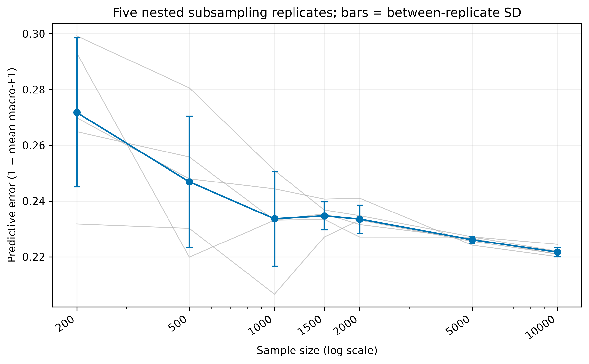
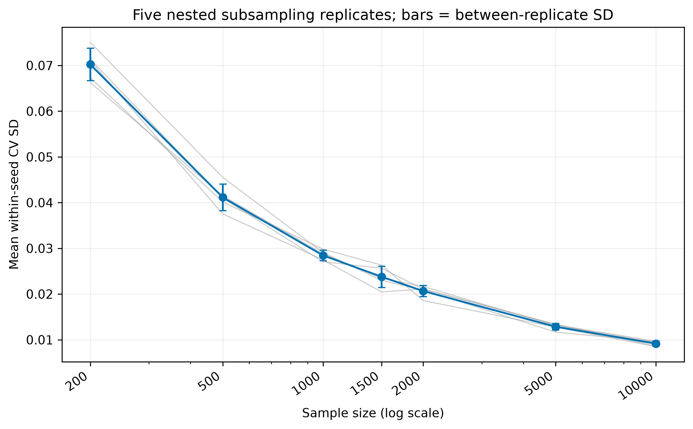
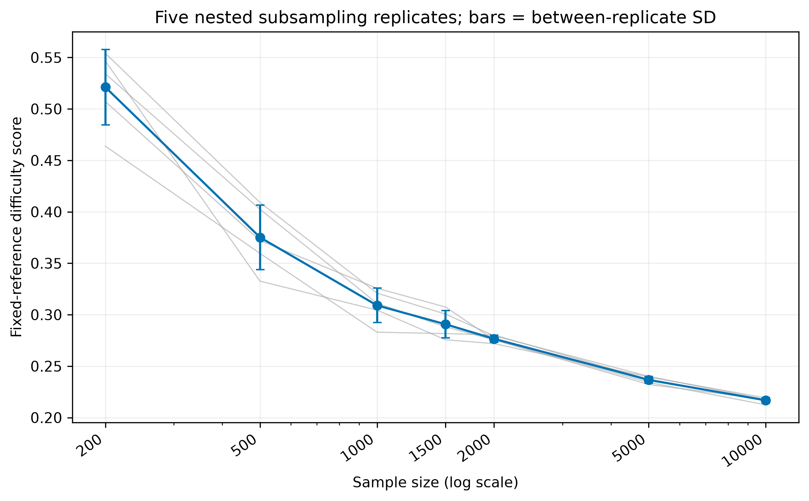
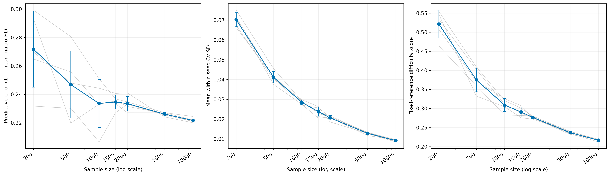
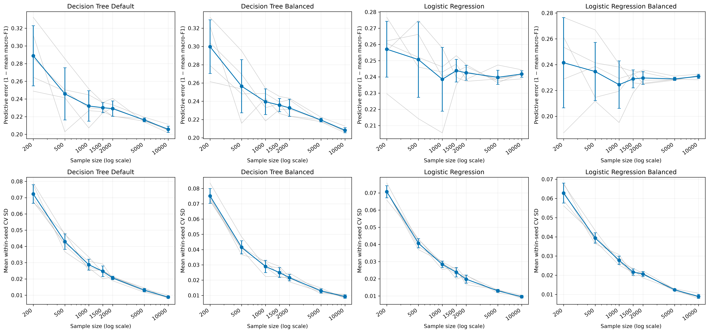

> **Final status — repository review:** The complete MAGIC scientific analysis and notebook section remain intact. Cached notebook images were cleared for publication and the display loader now verifies the curated artifact subset. No samples, partitions, scores or model records changed. See EXPERIMENT_INDEX.md.

# Block 7 — MAGIC controlled subsampling: final scientific report

## Completion and provenance

All **10,500/10,500** planned main-run evaluations are successful and unique: 35 samples × four canonical configurations × five CV seeds × 15 folds. Exactly 10,500 attempts were found, with no failures/retries. The separate 16-fold pilot is excluded. The optional full-data reference was not evaluated. All nine saved analytical tables were reproduced exactly from verified main-run records; no model was refitted and no sample or split was regenerated during Stage B. Source hashes, frozen configuration, full model parameters, environment, saved sample identities, partition identities, and fixed Block 3 endpoints agree. All 5,250 LR records contain only the known penalty deprecation warning; no convergence warnings were recorded.

## Dataset and design

The unchanged local data/magic04.data contains 19,020 rows, ten numeric UCI predictors and original g/h targets (12,332/6,688). There are no missing or malformed rows. The 115 duplicate complete rows are retained. SHA-256: `e9314b7ebd4b4b59a3b3d65f7316663963777b16a46786877651dbbaa640b36a`. Source: [UCI MAGIC Gamma Telescope](https://archive.ics.uci.edu/dataset/159/magic+gamma+telescope), DOI 10.24432/C52C8B. Local structure/counts match the source documentation; remote byte identity was not asserted. The .data file is comma-separated and parsed directly without conversion. Original physical row IDs are preserved.

Sizes are 200, 500, 1,000, 1,500, 2,000, 5,000 and 10,000. Independent randomized sampling sequences use seeds 101, 202, 303, 404 and 505. Within each sequence, one PCG64 permutation per class is used; largest-remainder proportional allocations (label-order ties) select nested prefixes. Selected IDs are sorted into original row order. Saved class counts differ from ideal allocations by less than one observation. There are 35 saved sample manifests and 175 saved CV collections. The five sequences can share original observations, and sizes within each sequence are nested.

Each sample uses 5-fold × 3-repeat stratified CV for seeds 42, 7, 21, 84 and 123. All four canonical models share exact folds: DT default/balanced and LR default/balanced. Frozen constructors, hyperparameters and random states are unchanged; imputation and LR scaling remain inside each training pipeline. Macro-F1 uses zero_division=0. Original-row mapping, disjoint train/test partitions, class coverage and once-per-repetition validation coverage were verified from saved indices.

## Score and three distinct variability quantities

For each model/sample/CV seed, F is the mean of 15 fold macro-F1 scores and within-CV variability is their sample SD (ddof=1). Model F and V average those respective statistics across five CV seeds; sample F and V average the four models equally. E = 1 − F. The primary V is not the pooled SD of 75 scores.

Between-subsample SD describes variation among the five sample-level summaries at a fixed size (also ddof=1). Between-CV-seed SD is the SD of the five seed-level mean scores for a fixed model and sample; the table below averages it across models and subsamples. These quantities have different units of replication and must not be substituted for one another. Error bars are descriptive between-subsample SD, not confidence intervals. Repeated folds are not independent statistical replicates.

| E_max_ref | E_min_ref | V_max_ref | V_min_ref |
| --- | --- | --- | --- |
| 0.703214 | 0.017873 | 0.079441 | 0.007066 |

The primary 17-dataset Block 3 endpoints remain fixed. E_norm = (E − E_min_ref)/(E_max_ref − E_min_ref), with the corresponding V expression; D_pred = 0.70 E_norm + 0.30 V_norm. None of the 35 sample-level components lies outside its reference range. No clipping or MAGIC-derived normalization was applied. MAGIC is not ranked with the canonical datasets and receives no Easy/Intermediate/Hard label.

## Sample-size results

Every row below summarizes five subsampling sequences. Values are unitless fractions, not percentages. Stored CSV values retain full precision.

| sample_size | mean_macro_f1_mean | error_mean | variability_mean | difficulty_score_mean | error_std | variability_std | difficulty_score_std |
| --- | --- | --- | --- | --- | --- | --- | --- |
| 200 | 0.728212 | 0.271788 | 0.070221 | 0.521132 | 0.026753 | 0.003527 | 0.036682 |
| 500 | 0.753106 | 0.246894 | 0.041139 | 0.375155 | 0.023592 | 0.002893 | 0.031454 |
| 1000 | 0.766367 | 0.233633 | 0.028455 | 0.309035 | 0.016934 | 0.001150 | 0.016748 |
| 1500 | 0.765319 | 0.234681 | 0.023779 | 0.290720 | 0.005003 | 0.002333 | 0.013177 |
| 2000 | 0.766491 | 0.233509 | 0.020656 | 0.276579 | 0.005072 | 0.001196 | 0.003419 |
| 5000 | 0.773903 | 0.226097 | 0.012845 | 0.236631 | 0.001260 | 0.000699 | 0.003343 |
| 10000 | 0.778330 | 0.221670 | 0.009149 | 0.216789 | 0.001712 | 0.000545 | 0.002570 |

| metric | n200 | n10000 | absolute_change | percent_change |
| --- | --- | --- | --- | --- |
| mean_macro_f1 | 0.728212 | 0.778330 | 0.050118 | 6.882294 |
| error | 0.271788 | 0.221670 | -0.050118 | -18.439990 |
| variability | 0.070221 | 0.009149 | -0.061073 | -86.971547 |
| difficulty_score | 0.521132 | 0.216789 | -0.304343 | -58.400317 |

From n=200 to n=10,000, macro-F1 increases by 0.050118 (5.012 percentage points), error decreases by 18.44%, V decreases by **86.97%**, and fixed-reference difficulty decreases by 58.40%. The much stronger relative decline in V is the central sample-size sensitivity finding. The score change decomposes algebraically into −0.051190 from normalized error and −0.253153 from normalized V: approximately 83.18% of the observed score decline comes from the variability term. This is a descriptive decomposition of this experiment, not a causal attribution or a change to the proposed weights.

## Monotonicity, adjacent changes and diminishing returns

| from_size | to_size | metric | replicates | mean_change | sd_change | minimum_change | maximum_change | increases | decreases | unchanged |
| --- | --- | --- | --- | --- | --- | --- | --- | --- | --- | --- |
| 200 | 500 | mean_macro_f1 | 5 | 0.024894 | 0.028203 | 0.001572 | 0.073270 | 5 | 0 | 0 |
| 200 | 500 | error | 5 | -0.024894 | 0.028203 | -0.073270 | -0.001572 | 0 | 5 | 0 |
| 200 | 500 | variability | 5 | -0.029083 | 0.003326 | -0.033556 | -0.024754 | 0 | 5 | 0 |
| 200 | 500 | difficulty_score | 5 | -0.145977 | 0.040884 | -0.213929 | -0.104213 | 0 | 5 | 0 |
| 500 | 1000 | mean_macro_f1 | 5 | 0.013261 | 0.017743 | -0.013241 | 0.029649 | 4 | 1 | 0 |
| 500 | 1000 | error | 5 | -0.013261 | 0.017743 | -0.029649 | 0.013241 | 1 | 4 | 0 |
| 500 | 1000 | variability | 5 | -0.012684 | 0.002667 | -0.016457 | -0.010045 | 0 | 5 | 0 |
| 500 | 1000 | difficulty_score | 5 | -0.066121 | 0.027672 | -0.091377 | -0.028112 | 0 | 5 | 0 |
| 1000 | 1500 | mean_macro_f1 | 5 | -0.001047 | 0.012605 | -0.020517 | 0.014188 | 2 | 3 | 0 |
| 1000 | 1500 | error | 5 | 0.001047 | 0.012605 | -0.014188 | 0.020517 | 3 | 2 | 0 |
| 1000 | 1500 | variability | 5 | -0.004676 | 0.002239 | -0.007021 | -0.001413 | 0 | 5 | 0 |
| 1000 | 1500 | difficulty_score | 5 | -0.018315 | 0.010296 | -0.028837 | -0.001334 | 0 | 5 | 0 |
| 1500 | 2000 | mean_macro_f1 | 5 | 0.001172 | 0.004697 | -0.006032 | 0.006288 | 3 | 2 | 0 |
| 1500 | 2000 | error | 5 | -0.001172 | 0.004697 | -0.006288 | 0.006032 | 2 | 3 | 0 |
| 1500 | 2000 | variability | 5 | -0.003123 | 0.003184 | -0.007763 | 0.000640 | 1 | 4 | 0 |
| 1500 | 2000 | difficulty_score | 5 | -0.014141 | 0.012603 | -0.031859 | -0.001349 | 0 | 5 | 0 |
| 2000 | 5000 | mean_macro_f1 | 5 | 0.007412 | 0.006118 | 0.000006 | 0.016850 | 5 | 0 | 0 |
| 2000 | 5000 | error | 5 | -0.007412 | 0.006118 | -0.016850 | -0.000006 | 0 | 5 | 0 |
| 2000 | 5000 | variability | 5 | -0.007811 | 0.001275 | -0.009212 | -0.005815 | 0 | 5 | 0 |
| 2000 | 5000 | difficulty_score | 5 | -0.039948 | 0.004473 | -0.043311 | -0.032452 | 0 | 5 | 0 |
| 5000 | 10000 | mean_macro_f1 | 5 | 0.004426 | 0.001142 | 0.002685 | 0.005697 | 5 | 0 | 0 |
| 5000 | 10000 | error | 5 | -0.004426 | 0.001142 | -0.005697 | -0.002685 | 0 | 5 | 0 |
| 5000 | 10000 | variability | 5 | -0.003696 | 0.001003 | -0.004778 | -0.002109 | 0 | 5 | 0 |
| 5000 | 10000 | difficulty_score | 5 | -0.019842 | 0.003149 | -0.022546 | -0.014562 | 0 | 5 | 0 |

| subsampling_seed | metric | spearman_size | increasing_steps | decreasing_steps | unchanged_steps |
| --- | --- | --- | --- | --- | --- |
| 101 | mean_macro_f1 | 0.964286 | 5 | 1 | 0 |
| 101 | error | -0.964286 | 1 | 5 | 0 |
| 101 | variability | -1.000000 | 0 | 6 | 0 |
| 101 | difficulty_score | -1.000000 | 0 | 6 | 0 |
| 202 | mean_macro_f1 | 0.428571 | 4 | 2 | 0 |
| 202 | error | -0.428571 | 2 | 4 | 0 |
| 202 | variability | -0.964286 | 1 | 5 | 0 |
| 202 | difficulty_score | -1.000000 | 0 | 6 | 0 |
| 303 | mean_macro_f1 | 0.357143 | 4 | 2 | 0 |
| 303 | error | -0.357143 | 2 | 4 | 0 |
| 303 | variability | -1.000000 | 0 | 6 | 0 |
| 303 | difficulty_score | -1.000000 | 0 | 6 | 0 |
| 404 | mean_macro_f1 | 0.964286 | 5 | 1 | 0 |
| 404 | error | -0.964286 | 1 | 5 | 0 |
| 404 | variability | -1.000000 | 0 | 6 | 0 |
| 404 | difficulty_score | -1.000000 | 0 | 6 | 0 |
| 505 | mean_macro_f1 | 1.000000 | 6 | 0 | 0 |
| 505 | error | -1.000000 | 0 | 6 | 0 |
| 505 | variability | -1.000000 | 0 | 6 | 0 |
| 505 | difficulty_score | -1.000000 | 0 | 6 | 0 |

Mean V and D_pred decrease at every adjacent size. Across individual sequences, V decreases in 29/30 adjacent comparisons; the exception is seed 202 from 1,500 to 2,000 (+0.000640). D_pred decreases in all 30 comparisons. Four sequences have size–V Spearman −1 and seed 202 has −0.964286. These correlations are descriptive, without p-values.

Macro-F1 is less monotonic: 24/30 adjacent changes are positive. Only seed 505 improves at every step. Size–F Spearman ranges from 0.357143 (303) to 1 (505). Between 1,000 and 1,500, mean F falls 0.001047 and E rises by the same amount, while V falls 0.004676 and D_pred falls 0.018315. Thus score improvement can accompany slightly worse predictive performance. At this transition three of five sequences lose F; at 1,500→2,000 two lose F. All five improve F at 200→500, 2,000→5,000 and 5,000→10,000.

| from_size | to_size | metric | mean_change_per_1000_observations |
| --- | --- | --- | --- |
| 200 | 500 | mean_macro_f1 | 0.082979 |
| 200 | 500 | error | -0.082979 |
| 200 | 500 | variability | -0.096942 |
| 200 | 500 | difficulty_score | -0.486588 |
| 500 | 1000 | mean_macro_f1 | 0.026522 |
| 500 | 1000 | error | -0.026522 |
| 500 | 1000 | variability | -0.025368 |
| 500 | 1000 | difficulty_score | -0.132242 |
| 1000 | 1500 | mean_macro_f1 | -0.002095 |
| 1000 | 1500 | error | 0.002095 |
| 1000 | 1500 | variability | -0.009353 |
| 1000 | 1500 | difficulty_score | -0.036629 |
| 1500 | 2000 | mean_macro_f1 | 0.002343 |
| 1500 | 2000 | error | -0.002343 |
| 1500 | 2000 | variability | -0.006246 |
| 1500 | 2000 | difficulty_score | -0.028282 |
| 2000 | 5000 | mean_macro_f1 | 0.002471 |
| 2000 | 5000 | error | -0.002471 |
| 2000 | 5000 | variability | -0.002604 |
| 2000 | 5000 | difficulty_score | -0.013316 |
| 5000 | 10000 | mean_macro_f1 | 0.000885 |
| 5000 | 10000 | error | -0.000885 |
| 5000 | 10000 | variability | -0.000739 |
| 5000 | 10000 | difficulty_score | -0.003968 |

Because size increments differ, changes per 1,000 added observations are also reported; these are finite differences, not extrapolated forecasts. The early 200→500 interval gains about 0.08298 F per 1,000 added observations versus 0.000885 at 5,000→10,000. Absolute V reductions per 1,000 likewise decline across all six intervals. The late F gain remains positive for every replicate, so a performance plateau is not established. Intermediate F reversals prevent claiming a globally smooth learning curve. No smoothing or monotonicity constraint was used.

## Between-subsample dispersion and CV-seed variation

| sample_size | mean_between_cv_seed_sd | mean_pooled_75_fold_sd |
| --- | --- | --- |
| 200 | 0.011514 | 0.069999 |
| 500 | 0.005346 | 0.040995 |
| 1000 | 0.003823 | 0.028423 |
| 1500 | 0.002868 | 0.023589 |
| 2000 | 0.002232 | 0.020699 |
| 5000 | 0.001612 | 0.012858 |
| 10000 | 0.001173 | 0.009167 |

Between-subsample SD of F (equal to that of E) shrinks from 0.026753 to 0.001712, V SD from 0.003527 to 0.000545, and score SD from 0.036682 to 0.002570. These endpoint reductions are not all monotonic: V dispersion rises at 1,500, while F/E dispersion increases slightly at 2,000 and again at 10,000. Sample composition still matters. The mean between-CV-seed SD of mean F falls from 0.011514 to 0.001173, a distinct statistic from primary V. Complete medians and ranges are retained in sample_size_summary.csv.

## Model-specific behavior

| model | sample_size | mean_macro_f1_mean | variability_mean | between_cv_seed_sd_mean |
| --- | --- | --- | --- | --- |
| decision_tree_balanced | 200 | 0.700241 | 0.075152 | 0.016298 |
| decision_tree_balanced | 500 | 0.743540 | 0.041496 | 0.006348 |
| decision_tree_balanced | 1000 | 0.760530 | 0.028905 | 0.005552 |
| decision_tree_balanced | 1500 | 0.764195 | 0.024967 | 0.005337 |
| decision_tree_balanced | 2000 | 0.767262 | 0.021618 | 0.003352 |
| decision_tree_balanced | 5000 | 0.780581 | 0.012888 | 0.002996 |
| decision_tree_balanced | 10000 | 0.791733 | 0.009257 | 0.002115 |
| decision_tree_default | 200 | 0.711151 | 0.072247 | 0.014646 |
| decision_tree_default | 500 | 0.754205 | 0.042951 | 0.008111 |
| decision_tree_default | 1000 | 0.767948 | 0.028754 | 0.005632 |
| decision_tree_default | 1500 | 0.769847 | 0.024709 | 0.003109 |
| decision_tree_default | 2000 | 0.770922 | 0.020621 | 0.003597 |
| decision_tree_default | 5000 | 0.783713 | 0.013092 | 0.002220 |
| decision_tree_default | 10000 | 0.794298 | 0.008817 | 0.001817 |
| logistic_regression | 200 | 0.742956 | 0.070685 | 0.007136 |
| logistic_regression | 500 | 0.749347 | 0.040696 | 0.003737 |
| logistic_regression | 1000 | 0.761483 | 0.028381 | 0.002042 |
| logistic_regression | 1500 | 0.756193 | 0.023807 | 0.001539 |
| logistic_regression | 2000 | 0.757470 | 0.019771 | 0.001039 |
| logistic_regression | 5000 | 0.760284 | 0.012999 | 0.000722 |
| logistic_regression | 10000 | 0.758240 | 0.009563 | 0.000395 |
| logistic_regression_balanced | 200 | 0.758500 | 0.062801 | 0.007978 |
| logistic_regression_balanced | 500 | 0.765332 | 0.039413 | 0.003186 |
| logistic_regression_balanced | 1000 | 0.775505 | 0.027780 | 0.002065 |
| logistic_regression_balanced | 1500 | 0.771042 | 0.021631 | 0.001485 |
| logistic_regression_balanced | 2000 | 0.770309 | 0.020613 | 0.000940 |
| logistic_regression_balanced | 5000 | 0.771034 | 0.012401 | 0.000507 |
| logistic_regression_balanced | 10000 | 0.769048 | 0.008958 | 0.000364 |

DT default improves from 0.711151 to 0.794298; balanced DT from 0.700241 to 0.791733. Both DT mean curves improve at every size. LR default improves less overall (0.742956→0.758240), and balanced LR changes 0.758500→0.769048. Both LR mean curves peak at n=1,000 in this grid and are slightly lower at n=10,000; the final 5,000→10,000 changes are −0.002044 and −0.001986, respectively. LR therefore benefits much less from additional observations under these fixed linear configurations, despite declining V. DT overtakes the corresponding LR mean by n=1,000 for default weighting and n=5,000 for balanced weighting. These are observed performance differences, not significance claims or evidence that tuning would behave similarly.

All four model-averaged V curves decrease at every size. Balanced LR has higher mean F than default LR at every size; default DT has higher mean F than balanced DT at every size. The complete model-by-replicate correlations and direction counts are in model_specific_trends.csv. Persistent LR error at large n while V declines shows that low partition variability does not imply near-perfect predictability.

## Reviewer 2 assessment and limitations

**R2.2:** the controlled experiment supports the concern that within-seed CV variability is substantially sample-size sensitive. Holding the underlying dataset, target definition, learner configurations and evaluation recipe fixed, increasing n fifty-fold is accompanied by an approximately 87% reduction in V. V should therefore be interpreted as observed predictive instability under a specified finite-sample evaluation design, not as a size-invariant intrinsic dataset property.

**Previous R2.5:** this is within-dataset evidence complementing descriptor–variability comparisons. It demonstrates a finite-sample contribution for MAGIC, but does not quantify or remove sample-size confounding across the original 17 datasets. It neither invalidates the canonical ranking nor establishes that its variability component measures sample size alone.

Training-fold size and validation-fold size increase together (approximately 160/40 at n=200 versus 8,000/2,000 at n=10,000). More training information, less validation sampling noise, model stability, sample composition and partition variation may all contribute. The design cannot isolate their causal contributions. Five randomized sequences are drawn from one finite dataset; they overlap, and adjacent sizes are nested. No ordinary independent-sample significance tests or fold-based confidence intervals are justified here. The duplicate rows retained by the unchanged row-level protocol may occur across folds. Results do not establish a universal relationship across datasets, learner families or alternative validation designs, nor demonstrate the behavior of an independent tree inducer.

## Publication figures and outputs

All five existing figure pairs were inspected. Labels are readable at their intended full sizes, numerical values agree with saved tables, x axes are logarithmic, and y values are unitless F-score/error/SD/score quantities. PNGs are 300 dpi and PDFs retain vector plotting. Gray trajectories represent five sequences; blue markers are equal-weight means and bars are ±1 between-sequence SD (not CI). Joint/model panels use the same convention. Model-panel y limits differ; compare labeled values rather than apparent slopes. No previous figure was overwritten.

[Vector PDF](analysis/block7-magic-subsampling-v1/sample_size_error.pdf)

[Vector PDF](analysis/block7-magic-subsampling-v1/sample_size_variability.pdf)

[Vector PDF](analysis/block7-magic-subsampling-v1/sample_size_difficulty_score.pdf)

[Vector PDF](analysis/block7-magic-subsampling-v1/joint_components.pdf)

[Vector PDF](analysis/block7-magic-subsampling-v1/model_specific_trends.pdf)

Original complete exports: `analysis/block7-magic-subsampling-v1/`. Additional full-precision reporting summaries: `analysis/block7-magic-report-v1/` (model/size summaries, variability diagnostics, adjacent rates, endpoint changes and score decomposition). Both directories have checksum manifests. The original Stage A report is preserved in `block7-magic-subsampling-v1/stage_a_report.md`.

## Notebook, tests and preservation

The appended **Block 7 — MAGIC Subsampling** section loads checksummed exports, displays key tables/figures and gives the interpretations above. Only its new display cells are executed. All 56 preceding cells and notebook metadata are preserved. No fitting or sample/CV generation occurs in the reporting modules or notebook section. Blocks 1–6, canonical rankings, original benchmark data, evaluation records, prepared MAGIC artifacts and environment are checked in `protocol/block7b_validation_report.json`. Validation tests in `test_block7b.py` are analysis-only; earlier Block 7 tests that fit preprocessing are intentionally not rerun in this stage.

Final checks passed: 29 analysis-only Block 3–6/7B tests; 20,734 protected pre-Block-7 files unchanged (the authorized notebook is checked cell-by-cell); 10,940 saved Block 7 files unchanged; all 17 original benchmark datasets validated against frozen byte and parsed-data fingerprints; all 56 previous notebook cells and metadata preserved, with eight appended cells and four executed display cells. All five PNGs have verified 300-dpi metadata. Git whitespace checks passed on branch clean.

To recompute the reporting summaries without writing, use derived(tables()) from experiments.protocol.block7b_reporting in the existing .venv. Existing exports have checksum manifests; the export module refuses overwrite. The main analysis already exists and was verified; no fitting command is needed. No commits, pushes, manuscript changes or canonical-score modifications were made.
