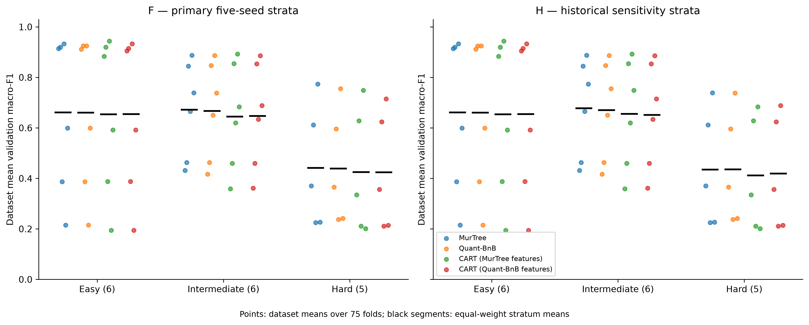
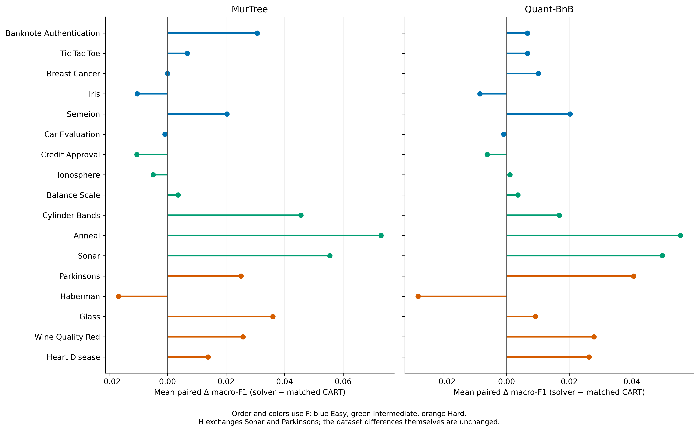
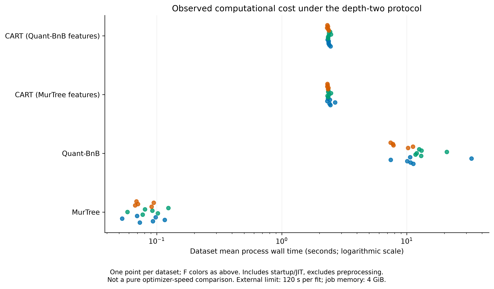
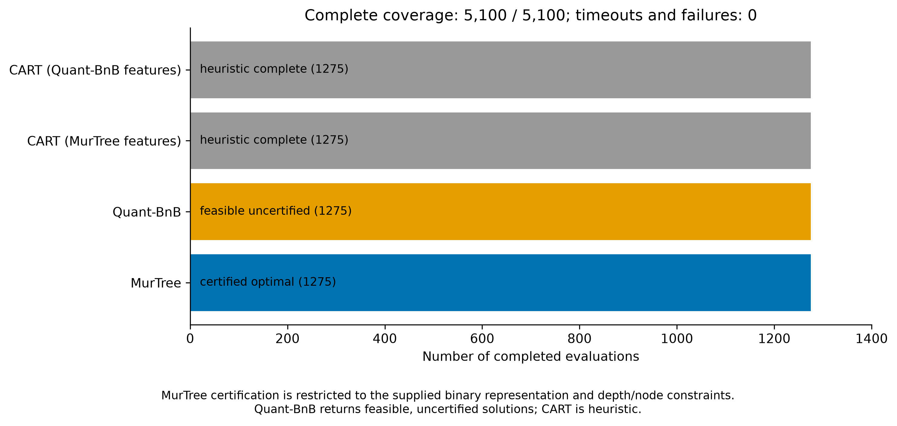

# Block 8 — Completed additional-inductor evaluation

**Final status:** the complete official depth-two experiment and scientific analysis are complete. The Phase 8A report retained below is historical, not current execution status. The first-stage report remains a separate historical diagnostic. No fitting was performed during this final analysis.

## Motivation, scope and reviewer correspondence

R2.1 and R3.1 request induction strategies absent from score construction. MurTree and Quant-BnB satisfy that design requirement across all 17 datasets. They offer complementary shallow-tree optimization objectives, but reuse the benchmark and saved partitions, so this is not fully independent statistical validation. The evidence supports organizing heterogeneous comparisons, not improved algorithm selection or generalization to unseen datasets.

## Frozen implementation and evaluation protocol

MurTree author source commit `129e0466acf43f5b4759fba8222800ce40aa32a3`; Quant-BnB commit `0a381a5bc6d689f66e5fca34a767da2c21918da0`. Original references: [MurTree, JMLR 2022](https://jmlr.org/papers/v23/20-520.html), [Quant-BnB, ICML 2022](https://proceedings.mlr.press/v162/mazumder22a.html). C++14 was built with portable Zig 0.13.0; Quant-BnB ran with Julia 1.10.10 and JSON 0.21.4. Python 3.12.14 and the existing unified package versions were unchanged. See configuration_summary.json for exact settings and packages; source files and binaries are bound by the immutable local configuration.

Training-only numerical median and categorical mode imputation, constant removal, and categorical one-hot encoding were used. MurTree receives at most 16 evenly ranked training-value midpoint cuts per original numerical feature. Quant-BnB retains continuous numerical values. Native multiclass paths are used. MurTree: depth ≤2, ≤3 decision nodes, sparsity penalty zero. Quant-BnB: native depth 2, s=3, mid_method=2, mid_ratio=0.2, classification C, original greedy upper bound ×(1+1e−6); its iteration cap can terminate without certification. Each separate matched CART uses the exact solver representation, Gini splitting, no class weighting, max_depth=2, and random_state=42.

All models use the same five saved CV seeds (42, 7, 21, 84, 123), three repetitions and five folds. External limits are 120 seconds and 4 GiB aggregate job committed memory; MurTree also has a 120-second internal limit. Execution is serial with one numerical thread using the tested v2 Windows job controller. Preprocessing is excluded from process wall time; startup, imports and Julia JIT are included. Budgets are not pure optimization-speed measures.

## Final coverage and certification

All 5100/5,100 fits succeeded; no missing evaluations, timeouts, failures or unsupported datasets. All 2,550 matched solver/CART pairs have identical folds and representations. MurTree reports 1,275 certified optimal solutions within the supplied constrained binary space; Quant-BnB reports 1,275 feasible, uncertified solutions. Both CART configurations complete 1,275 heuristic fits. All returned trees have depth two; Quant-BnB uses three decision nodes and the other configurations use two or three. Training-error optimality is not validation macro-F1 optimality.

| model | execution_status | termination_status | fits |
| --- | --- | --- | --- |
| cart_depth2_murtree | success | heuristic_complete | 1275 |
| cart_depth2_quant_bnb | success | heuristic_complete | 1275 |
| murtree | success | certified_optimal | 1275 |
| quant_bnb | success | feasible_uncertified | 1275 |

## Dataset-level validation performance

Each value averages five seed means of 15 fold scores each (equivalently 75 scores in this balanced grid). Macro-F1 is a unitless fraction. No intermediate rounding is used.

| dataset | cart_depth2_murtree | cart_depth2_quant_bnb | murtree | quant_bnb |
| --- | --- | --- | --- | --- |
| anneal | 0.358722 | 0.361223 | 0.431655 | 0.416702 |
| balance_scale | 0.459511 | 0.459511 | 0.463126 | 0.463126 |
| banknote | 0.883223 | 0.905043 | 0.913874 | 0.911669 |
| breast_cancer | 0.919845 | 0.914667 | 0.919873 | 0.924804 |
| car | 0.387914 | 0.387914 | 0.387003 | 0.387003 |
| credit_approval | 0.854683 | 0.853686 | 0.844242 | 0.847461 |
| cylinder_bands | 0.619641 | 0.633584 | 0.665170 | 0.650366 |
| glass | 0.334760 | 0.356699 | 0.370762 | 0.365884 |
| haberman | 0.628314 | 0.624348 | 0.611589 | 0.596100 |
| heart_disease | 0.210836 | 0.210777 | 0.224698 | 0.237086 |
| ionosphere | 0.892250 | 0.885534 | 0.887349 | 0.886605 |
| iris | 0.943663 | 0.933270 | 0.933325 | 0.924776 |
| parkinsons | 0.748727 | 0.715005 | 0.773853 | 0.755506 |
| semeion | 0.194573 | 0.194573 | 0.214868 | 0.214868 |
| sonar | 0.683686 | 0.688101 | 0.739098 | 0.737794 |
| tic_tac_toe | 0.592230 | 0.592230 | 0.598953 | 0.598953 |
| wine_red | 0.200983 | 0.213975 | 0.226780 | 0.241877 |

## Representation-matched CART differences

Solver minus matched depth-two CART is calculated within each exact fold, then averaged over 75 pairs per dataset. This comparison matches representation and depth, but the solver training-misclassification objective differs from greedy CART Gini. Positive, exactly zero and negative signs are classified before rounding.

| dataset | model | pairs | mean_delta | stratum_F | stratum_H |
| --- | --- | --- | --- | --- | --- |
| anneal | murtree | 75 | 0.072933 | intermediate | intermediate |
| anneal | quant_bnb | 75 | 0.055479 | intermediate | intermediate |
| balance_scale | murtree | 75 | 0.003615 | intermediate | intermediate |
| balance_scale | quant_bnb | 75 | 0.003615 | intermediate | intermediate |
| banknote | murtree | 75 | 0.030651 | easy | easy |
| banknote | quant_bnb | 75 | 0.006626 | easy | easy |
| breast_cancer | murtree | 75 | 0.000028 | easy | easy |
| breast_cancer | quant_bnb | 75 | 0.010137 | easy | easy |
| car | murtree | 75 | -0.000911 | easy | easy |
| car | quant_bnb | 75 | -0.000911 | easy | easy |
| credit_approval | murtree | 75 | -0.010442 | intermediate | intermediate |
| credit_approval | quant_bnb | 75 | -0.006226 | intermediate | intermediate |
| cylinder_bands | murtree | 75 | 0.045530 | intermediate | intermediate |
| cylinder_bands | quant_bnb | 75 | 0.016782 | intermediate | intermediate |
| glass | murtree | 75 | 0.036002 | hard | hard |
| glass | quant_bnb | 75 | 0.009184 | hard | hard |
| haberman | murtree | 75 | -0.016725 | hard | hard |
| haberman | quant_bnb | 75 | -0.028247 | hard | hard |
| heart_disease | murtree | 75 | 0.013862 | hard | hard |
| heart_disease | quant_bnb | 75 | 0.026309 | hard | hard |
| ionosphere | murtree | 75 | -0.004901 | intermediate | intermediate |
| ionosphere | quant_bnb | 75 | 0.001071 | intermediate | intermediate |
| iris | murtree | 75 | -0.010338 | easy | easy |
| iris | quant_bnb | 75 | -0.008494 | easy | easy |
| parkinsons | murtree | 75 | 0.025126 | hard | intermediate |
| parkinsons | quant_bnb | 75 | 0.040501 | hard | intermediate |
| semeion | murtree | 75 | 0.020295 | easy | easy |
| semeion | quant_bnb | 75 | 0.020295 | easy | easy |
| sonar | murtree | 75 | 0.055411 | intermediate | hard |
| sonar | quant_bnb | 75 | 0.049693 | intermediate | hard |
| tic_tac_toe | murtree | 75 | 0.006723 | easy | easy |
| tic_tac_toe | quant_bnb | 75 | 0.006723 | easy | easy |
| wine_red | murtree | 75 | 0.025797 | hard | hard |
| wine_red | quant_bnb | 75 | 0.027901 | hard | hard |

## Primary F and historical H sensitivity

F is the frozen primary Block 3 five-seed reference (Sonar Intermediate, Parkinsons Hard). H is the manuscript historical reference (Parkinsons Intermediate, Sonar Hard). All other memberships agree. Each stratum contains 6/6/5 equally weighted dataset observations. Fold scores are not independent datasets. These are fixed groupings; neither solver changes canonical scores or labels.

| stratification | stratum | model | datasets | mean_delta | positive | zero | negative |
| --- | --- | --- | --- | --- | --- | --- | --- |
| F | easy | murtree | 6 | 0.007742 | 4 | 0 | 2 |
| F | hard | murtree | 5 | 0.016812 | 4 | 0 | 1 |
| F | intermediate | murtree | 6 | 0.027024 | 4 | 0 | 2 |
| F | easy | quant_bnb | 6 | 0.005729 | 4 | 0 | 2 |
| F | hard | quant_bnb | 5 | 0.015130 | 4 | 0 | 1 |
| F | intermediate | quant_bnb | 6 | 0.020069 | 5 | 0 | 1 |
| H | easy | murtree | 6 | 0.007742 | 4 | 0 | 2 |
| H | hard | murtree | 5 | 0.022870 | 4 | 0 | 1 |
| H | intermediate | murtree | 6 | 0.021977 | 4 | 0 | 2 |
| H | easy | quant_bnb | 6 | 0.005729 | 4 | 0 | 2 |
| H | hard | quant_bnb | 5 | 0.016968 | 4 | 0 | 1 |
| H | intermediate | quant_bnb | 6 | 0.018537 | 5 | 0 | 1 |

F paired means (Easy, Intermediate, Hard) are MurTree +0.007742/+0.027024/+0.016812 and Quant-BnB +0.005729/+0.020069/+0.015130. H sensitivity means are +0.007742/+0.021977/+0.022870 and +0.005729/+0.018537/+0.016968. Counts are 4/6, 4/6, 4/5 positive for MurTree and 4/6, 5/6, 4/5 for Quant-BnB under either grouping; exact zeros are absent. Identical counts do not imply identical membership or means.

| model | stratum | datasets | mean_macro_f1 | mean_wall_seconds | mean_depth | mean_leaves | stratification |
| --- | --- | --- | --- | --- | --- | --- | --- |
| cart_depth2_murtree | easy | 6 | 0.653575 | 2.438279 | 2 | 3.671111 | F |
| cart_depth2_murtree | hard | 5 | 0.424724 | 2.336337 | 2 | 4.000000 | F |
| cart_depth2_murtree | intermediate | 6 | 0.644749 | 2.378301 | 2 | 3.764444 | F |
| cart_depth2_quant_bnb | easy | 6 | 0.654616 | 2.386145 | 2 | 3.666667 | F |
| cart_depth2_quant_bnb | hard | 5 | 0.424161 | 2.341050 | 2 | 3.989333 | F |
| cart_depth2_quant_bnb | intermediate | 6 | 0.646940 | 2.396277 | 2 | 3.824444 | F |
| murtree | easy | 6 | 0.661316 | 0.083943 | 2 | 3.544444 | F |
| murtree | hard | 5 | 0.441536 | 0.078589 | 2 | 4.000000 | F |
| murtree | intermediate | 6 | 0.671773 | 0.089162 | 2 | 3.951111 | F |
| quant_bnb | easy | 6 | 0.660345 | 13.864828 | 2 | 4.000000 | F |
| quant_bnb | hard | 5 | 0.439291 | 8.896776 | 2 | 4.000000 | F |
| quant_bnb | intermediate | 6 | 0.667009 | 13.910467 | 2 | 4.000000 | F |
| cart_depth2_murtree | easy | 6 | 0.653575 | 2.438279 | 2 | 3.671111 | H |
| cart_depth2_murtree | hard | 5 | 0.411716 | 2.339372 | 2 | 4.000000 | H |
| cart_depth2_murtree | intermediate | 6 | 0.655589 | 2.375772 | 2 | 3.764444 | H |
| cart_depth2_quant_bnb | easy | 6 | 0.654616 | 2.386145 | 2 | 3.666667 | H |
| cart_depth2_quant_bnb | hard | 5 | 0.418780 | 2.352076 | 2 | 4.000000 | H |
| cart_depth2_quant_bnb | intermediate | 6 | 0.651424 | 2.387089 | 2 | 3.815556 | H |
| murtree | easy | 6 | 0.661316 | 0.083943 | 2 | 3.544444 | H |
| murtree | hard | 5 | 0.434585 | 0.085182 | 2 | 4.000000 | H |
| murtree | intermediate | 6 | 0.677566 | 0.083668 | 2 | 3.951111 | H |
| quant_bnb | easy | 6 | 0.660345 | 13.864828 | 2 | 4.000000 | H |
| quant_bnb | hard | 5 | 0.435748 | 9.363973 | 2 | 4.000000 | H |
| quant_bnb | intermediate | 6 | 0.669961 | 13.521136 | 2 | 4.000000 | H |

## Unrestricted canonical CART — separate comparison

This reference is the default unweighted CART from the completed unified five-seed baseline run, not the historical H execution and not an additional fit. Its saved dataset/split/environment identities match. Representation and depth are not matched, so these deltas cannot isolate the optimization algorithm. H here is only a grouping, never a substitution of historical prediction scores.

| stratification | stratum | model | datasets | mean_delta | positive | zero | negative |
| --- | --- | --- | --- | --- | --- | --- | --- |
| F | easy | murtree | 6 | -0.248370 | 0 | 0 | 6 |
| F | hard | murtree | 5 | -0.088843 | 1 | 0 | 4 |
| F | intermediate | murtree | 6 | -0.098433 | 3 | 0 | 3 |
| F | easy | quant_bnb | 6 | -0.249341 | 1 | 0 | 5 |
| F | hard | quant_bnb | 5 | -0.091089 | 1 | 0 | 4 |
| F | intermediate | quant_bnb | 6 | -0.103197 | 3 | 0 | 3 |
| H | easy | murtree | 6 | -0.248370 | 0 | 0 | 6 |
| H | hard | murtree | 5 | -0.078146 | 2 | 0 | 3 |
| H | intermediate | murtree | 6 | -0.107347 | 2 | 0 | 4 |
| H | easy | quant_bnb | 6 | -0.249341 | 1 | 0 | 5 |
| H | hard | quant_bnb | 5 | -0.076983 | 2 | 0 | 3 |
| H | intermediate | quant_bnb | 6 | -0.114952 | 2 | 0 | 4 |

Both solvers have negative stratum-average differences against unrestricted unified CART under F and H. The matched shallow-tree gains must not be described as superiority to unrestricted trees. The complete dataset-level canonical comparisons are in dataset_paired_deltas.csv.

## Runtime, complexity and scientific limitations

| model | fits | wall_min | wall_median | wall_mean | wall_p95 | wall_max | peak_job_memory_bytes | depth_min | depth_max | decision_nodes_min | decision_nodes_max |
| --- | --- | --- | --- | --- | --- | --- | --- | --- | --- | --- | --- |
| cart_depth2_murtree | 1275 | 2.118764 | 2.345461 | 2.387127 | 2.587650 | 23.941546 | 122142720 | 2 | 2 | 2 | 3 |
| cart_depth2_quant_bnb | 1275 | 2.107092 | 2.352678 | 2.376458 | 2.580474 | 4.188872 | 122118144 | 2 | 2 | 2 | 3 |
| murtree | 1275 | 0.030721 | 0.075360 | 0.084210 | 0.133989 | 0.628522 | 10104832 | 2 | 2 | 2 | 3 |
| quant_bnb | 1275 | 7.134968 | 11.418860 | 12.419744 | 21.716347 | 43.427014 | 510820352 | 2 | 2 | 3 | 3 |

Runtime summaries describe observed process durations (including startup/JIT); p95 is a descriptive quantile, not an inferential bound. The plot uses dataset mean runtimes. Quant-BnB has its largest dataset mean on Easy Semeion (about 32.969 s), while Hard group mean runtime is lower than Easy under H. Predictive difficulty does not order optimization cost. A shallow four-leaf ceiling is restrictive for ten-class Semeion; its macro-F1 is about 0.2149 under both solvers despite its Easy canonical assignment. Hard means are lower overall, but Easy and Intermediate are not consistently ordered. Individual datasets overlap; depth, representation, objective and training information affect the result. Repeated folds and seeds reuse observations. No significance tests treating folds as independent datasets, causal interpretations, or claims of unseen-dataset generalization are made.

## Figures and reproducibility

All figures use dataset-level observations except the explicitly labeled execution-status counts. F/H performance panels are separate; dataset deltas themselves do not depend on grouping. Runtime axes are logarithmic. PNG exports use 300 dpi; PDF exports preserve vector graphics.

[Vector PDF](analysis/block8-scientific-v1/performance_by_stratum.pdf)

[Vector PDF](analysis/block8-scientific-v1/dataset_matched_differences.pdf)

[Vector PDF](analysis/block8-scientific-v1/runtime_by_method.pdf)

[Vector PDF](analysis/block8-scientific-v1/solver_status.pdf)

The appended Block 8 notebook section loads published_checksums.json-verified exports and performs no fitting. To regenerate all scientific summaries from the private full record/artifact store, run `python -m experiments.protocol.block8_scientific --output experiments/analysis/block8-scientific-reproduction`. Existing directories are refused. Rendering the report is separate: `python -m experiments.protocol.block8_scientific_report` (refuses to prepend a second completed report). Review-only loading requires no runtime sidecars or raw fold stores. See ../README.md and EXPERIMENT_INDEX.md for archive dependencies and setup limitations.

## Validation and preservation

The new audit verified 253 frozen source/runtime/split files and 38250 fit artifacts, 5,100 checksummed official records, and 1,275 unrestricted CART records. The existing full_execution_validation.json also records exact score recomputation for all 5,100 saved prediction outputs. New paired checks verify 75 unique matching folds for every dataset and comparison. All previously verified F/H six-decimal means were reproduced from records. See repository_review/VALIDATION.md for final tests, notebook preservation and repository checks. Full source-record checksums are in provenance.json. No model was retrained and no saved record was overwritten.

## Archived Phase 8A feasibility findings (original text follows)

The status and future-tense statements below describe the historical pilot stage only. They are retained as implementation evidence and are superseded by the completed full-run status above.

# Block 8 — Alternative induction strategies: Phase 8A feasibility

## Status and resumed work

Phase 8A is complete on branch `clean`; Phase 8B has **not** run. On resumption, the isolated runtimes, author-source checkouts, MurTree executable, preprocessing/adapter code, 34-row compatibility matrix and all ten solver pilot checkpoints were already present. All ten fits had completed normally, and no solver process remained active. Those successful fits were retained, not repeated. The original pilot configuration and code remain frozen evidence.

Completed after resumption: fixed and tested process-tree timeout enforcement in a separately versioned controller; prepared and ran matched depth-2 CART pilots; exported compatibility, coverage and feasibility diagnostics; verified original records/data/splits; documented the proposed full-run choices. No scientific stratum conclusions or publication plots are produced from this pilot.

## Author implementations and isolated environments

| Property | MurTree | Quant-BnB |
|---|---|---|
| Source | [authors' repository](https://github.com/MurTree/murtree) | [authors' repository](https://github.com/mengxianglgal/Quant-BnB) |
| Pinned commit | `129e0466acf43f5b4759fba8222800ce40aa32a3` | `0a381a5bc6d689f66e5fca34a767da2c21918da0` |
| Language/runtime used | C++14, portable Zig 0.13.0 C++ compiler | Portable Julia 1.10.10, JSON 0.21.4 |
| License | MIT | No explicit license file found in pinned source; source kept local and excluded from Git |
| Native features | Binary | Continuous/binary numeric matrix |
| Native targets | Multiple integer class codes | One-hot target matrix, native classification objective |
| Optimization objective | Training misclassification count, optional sparsity penalty (zero here) | Training misclassification count, classification mode C |
| Complexity | Maximum depth and decision-node count | Published depth-2/depth-3 implementations |
| Proprietary solver | None | None |
| Prediction | Original node branch/label semantics, serialized tree | Original `tree_eval` |
| Optimality signal | Original solver's `is_proven_optimal` flag | No separate certificate field in original return API |

Papers: [MurTree, JMLR 2022](https://jmlr.org/papers/v23/20-520.html); [Quant-BnB, ICML 2022](https://proceedings.mlr.press/v162/mazumder22a.html). Source-level evidence and exact file hashes are in the provenance/environment manifests. MurTree explicitly documents Windows Visual Studio and Linux builds; its CMake route requires CMake 3.16.1 and C++14. The portable compiler was used without CMake. Its first build encountered Windows/cache errors; a short temporary cache and the second build succeeded, with compiler-library warnings preserved in logs. Source optimization code was not patched. The C++ bridge includes the original main file to reuse parameter definitions and calls the original solver, then serializes its tree and status.

Quant-BnB does not specify an OS support matrix or pinned Julia project. Native Windows execution was demonstrated using a local project/depot. `LinearAlgebra` is a Julia standard library; JSON and its resolved dependencies are locked in the saved Project/Manifest files. Existing WSL contained only docker-desktop; the Docker engine was not running. Neither was modified. Portable runtime archives were checked against their official SHA-256 metadata. Nothing was installed system-wide, and canonical `.venv` packages were unchanged. Sidecars/vendor source/build/work files are excluded by the new Block 8 `.gitignore`; no canonical ignore rules were changed.

## Native multiclass and compatibility

No One-vs-Rest or other optimization-changing wrapper is used. MurTree has specialized binary and general multiclass solver paths, and Quant-BnB classification operates on arbitrary target-matrix columns. Pilots exercised binary data, Iris (three classes), and Semeion (ten classes). Original encoded class IDs are restored after prediction.

All 17 datasets passed first-saved-fold representation preparation for both algorithms; the compatibility matrix contains all 34 pairs. This is input compatibility, not a claim of 75-fold runtime feasibility. Twelve datasets per algorithm have not been trained in this bounded pilot. The original MurTree text reader infers feature width from line length, so the adapter rejects more than ten classes; the current benchmark has at most ten. No current dataset is excluded on that basis.

Canonical labels are read from the verified Block 3 mixed five-seed export. Block 5 stability outputs and Block 6 DT-only/regularization exports were inspected and checksum-validated. The three cleaned notebooks were inspected without execution. Alternative inductors do not enter the difficulty score, and no chance-corrected labels are used.

## Train-fold-only representation

Only original saved CV indices are loaded (`verify_regeneration=False`). No folds or datasets are regenerated, subsampled or rewritten.

- Numeric columns: training median imputation; all-missing columns use a fixed zero fallback and are then removed as constant. Nonfinite numeric values are treated as missing by this separate adapter. Training-constant columns are removed.
- Categorical columns: training mode, lexicographic tie-break; one-hot categories learned on training rows. Unseen validation categories map to all zeros. All-missing/constant categorical columns are removed. No full-dataset category discovery is used.
- MurTree: adjacent distinct training numeric values define midpoint cuts. Up to 16 cuts per original numerical feature are selected at evenly spaced ranks of the distinct-cut list (rounded indices with duplicates removed). Feature value is `x > cut`. Binary-valued columns produce one cut. This is a fixed coarse representation, not supervised threshold tuning or native continuous optimization.
- Quant-BnB: imputed continuous numerical values are retained; categorical one-hot features are appended. No scaling or threshold discretization is imposed.

The 16-cut cap was a feasibility choice to avoid thousands of binary features per continuous attribute, not a validation-score-tuned parameter. It is **proposed for approval**, not silently frozen for Phase 8B. MurTree optimality pertains only to this supplied binary feature space and depth/node constraints. The two solver representations differ, so this is not a pure algorithm-only comparison. No-feature folds fail explicitly rather than receiving an invented score or replacement tree.

## Bounded pilot and observed diagnostics

Five preselected datasets, CV seed 42, repetition 1, fold 1, both solvers: ten fits. Coverage includes small binary (Breast Cancer), categorical (Tic-Tac-Toe), multiclass (Iris), high dimensional/multiclass (Semeion), and Hard (Haberman). It does not provide balanced coverage of the three strata; no stratum-level conclusions are warranted.

Initial pilot: depth ≤2, ≤3 decision nodes for MurTree, zero sparsity penalty, original default solver options and seed 42; MurTree internal budget 30 seconds, external wall budget 120 seconds; one Julia/BLAS thread. Quant-BnB uses the authors' depth-2 example settings `s=3`, `mid_method=2`, `mid_ratio=0.2`, `treetype=C` and the original greedy-tree upper bound multiplied by `(1+1e-6)`. That greedy warm start is not our sklearn CART comparison.

| Dataset | MurTree validation macro-F1 | MurTree wall s | Quant-BnB validation macro-F1 | Quant-BnB wall s |
|---|---:|---:|---:|---:|
| Breast Cancer | 0.953534 | 0.480849 | 0.953534 | 26.380086 |
| Tic-Tac-Toe | 0.606882 | 0.251245 | 0.606882 | 7.617086 |
| Iris | 0.933333 | 0.107745 | 0.933333 | 7.628875 |
| Semeion | 0.201880 | 0.110173 | 0.201880 | 36.610193 |
| Haberman | 0.675817 | 0.114259 | 0.723214 | 12.815790 |

These are pipeline/functionality diagnostics from one fold, not performance estimates. All ten fits returned usable trees with depth 2 and two or three decision nodes. MurTree reported optimality in all five. Quant-BnB returned an empty residual search array in all five, but remains conservatively recorded as **feasible, uncertified** because its API has no explicit certification field and its loop can stop after 20 iterations. We do not infer an optimum merely from normal process exit. No timeout/failure occurred in the ten fits. Quant-BnB returned-function solver timing includes Julia compilation on first invocation and original greedy initialization; total wall time also includes process startup/imports. This is not a clean language-independent optimization-speed comparison.

Polled peak working sets were approximately 4.1–5.3 MB for MurTree and 434–514 MB for Julia. They are process-level observations, not full-system memory measurements. The pilot's former memory policy was monitoring only. The new controller supports a hard job committed-memory cap, a different quantity that will be recorded distinctly in subsequent runs.

## Timeout issue found and fixed without changing previous results

The initial process controller attempted `taskkill`; its timeout regression test failed because termination was not reliable in the sandbox. All recorded solver fits nevertheless completed normally below budget. The original `block8.py` remains frozen to preserve those records' source identity and should not be used as the production controller.

The separate `block8_process.py` uses Windows job objects: a hard aggregate committed-memory limit, explicit termination at wall deadline, and kill-on-close for the attached process tree on interruption. Parent/child cleanup and real Julia timeout regression tests pass. Memory allocation failures are recorded as nonzero exits; they are not automatically mislabeled as solver timeouts. Assignment failure aborts safely. `block8_adapters.py` selects this v2 controller without changing either optimizer. The dispatcher is serial and not thread-safe for concurrent use; a full runner must preserve that execution policy or isolate workers.

MurTree's original solver sets its tree pointer to null when its internal timer expires, even if a numeric best objective exists; it cannot provide validation predictions from that objective. Quant-BnB depth 2 has no native time-limit argument and can stop at an iteration cap; depth 3 has a time-limit argument but still lacks a clean certification return. If a returned tree is absent (including the original zero-upper-bound/no-improvement edge case), the adapter records no usable solution. No fallback optimizer, fabricated prediction or zero macro-F1 is substituted.

## Matched CART baseline requested on resumption

A separate configuration uses the original default CART estimator settings with **only `max_depth=2` changed**, unbalanced class weighting and the original random state. It is evaluated twice per split: once on exactly the MurTree binary representation and once on exactly the Quant-BnB continuous/one-hot representation. Training preprocessing specifications were checked against the existing solver pilot artifacts.

All ten matched CART pilot fits succeeded on exactly the same saved fold identities. Results and configuration IDs are separate from canonical records. CART depth and representation are matched; its greedy Gini objective still differs from the solvers' global misclassification objective. These baselines complement the planned paired comparison against the unchanged saved default CART (and balanced CART secondarily); they do not replace the original baselines or score. Matched pilot differences are exported only as diagnostics, without scientific claims.

## Proposed Phase 8B protocol and resource gate

Recommend depth 2 initially because it is the smallest common published shallow-tree setting and all five representative cases completed. Depth 3 has not been feasibility-tested and should be a separate configuration, not an automatic extension.

Proposed common external wall cap: **120 seconds per solver process**, one thread, **4 GiB job committed-memory cap**. Set MurTree's internal budget to 120 seconds as well; the external cap takes precedence, so no optimum or incumbent is assumed if killed. Quant-BnB startup/JIT remains inside the same external budget and is disclosed. Changing from the pilot's 30-second MurTree internal limit and monitoring-only memory policy requires a new full-run configuration ID.

All 17 datasets × 75 saved folds × two solvers = **2,550 solver fits**. Two matched depth-2 CART representations add **2,550 separate CART fits**, for **5,100 new fits**, subject to approval. At 120 seconds, the solver budget ceiling alone is **85 hours serial**, plus preprocessing, CART, I/O and validation overhead. The observed five-fold Quant-BnB mean is about 18.2 seconds, but extrapolation to untested datasets is not reliable. No dataset may be dropped after seeing performance; all unsupported/time-limited cases remain in coverage reports.

Before Phase 8B authorization, approve: (1) depth 2 and the 16-cut MurTree representation, (2) the common wall/memory budget and complete 75-fold design, (3) the two separately configured matched CART baselines, and (4) reporting Quant-BnB predictions as uncertified unless a further source-level certificate audit establishes a safe criterion. If the 85-hour ceiling is unacceptable, agree on a shared prespecified subset of existing folds before execution; do not silently reduce coverage.

There is currently no enabled full-run action. After choices are approved, the existing Store/runner architecture can be extended to the approved plan using v2 process containment and a new immutable configuration. No full-run command is provided before that freeze.

## Artifacts and reproducibility

- `block8-optimal-trees-v1/`: author source/runtime sidecars (local, ignored), immutable pilot configurations/checkpoints, exact saved-fold work inputs, build logs, source/binary/package checksums, compatibility preparation and preservation snapshot.
- `analysis/block8-feasibility-v1/`: `algorithm_compatibility.csv`, `feasibility_report.csv`, `matched_cart_pilot.csv`, `pilot_matched_cart_differences.csv`, `evaluation_coverage.csv`, `algorithm_environment_manifest.json`, Julia Project/Manifest copies, `proposed_protocol.json`, `provenance.json`, and checksums.
- Reusable modules: `block8.py` (frozen original pilot adapter), `block8_process.py` (tested containment v2), `block8_adapters.py` (v2 dispatcher), `block8_cart.py` (matched CART pilot), `block8_report.py` (diagnostic exports), `test_block8.py`.

Checkpointing reuses checksummed immutable attempts and an OS writer lock. Successful fits are skipped; failed attempts can be retried without replacing prior attempts. Parameter/source/runtime changes require a new version. Resumed successful records were validated without recomputation. The matched CART runner likewise supports skip-on-success. The full-run adapter must use v2 containment rather than the archived pilot controller.

## Interpretation and reviewer traceability

R2.1 and R3.1 motivate independent induction methods absent from the canonical score; Phase 8A establishes that the original implementations and data exchange work on representative saved folds. It does **not** establish useful stratification or superiority over CART. R1.4 will be addressed by complete, exactly paired comparisons under the approved constraints.

Training-error optimality is not validation macro-F1 optimality. Depth 2 has at most four leaves, a strong restriction for multiclass datasets such as ten-class Semeion. Representation coarsening, depth, objectives and time limits can affect outcomes independently of canonical difficulty. The proposed score measures predictive error/variability under DT/LR, not search complexity; neither slow solving nor a certificate is synonymous with predictive difficulty. Fixed strata are partly CART-derived, so future CART improvements are not fully independent of the characterization framework. No findings from these pilots justify a claim of generalization to unseen datasets or independent inductors.

The notebook and manuscript remain unchanged. Scientific plots and the Block 8 notebook section are deferred until an authorized, validated evaluation is available. No commits, pushes, merges, system-wide dependency installations or branch switches were performed.

## Final validation evidence

All 36 tests passed across Blocks 3–6, 7B and 8, including seven Block 8 infrastructure tests covering parent/descendant cleanup, a real Julia timeout, training-only preprocessing, unknown categories, multiclass prediction restoration, checkpoint retry/no-overwrite and the disabled full-run gate. All ten solver and ten matched CART records validated; Quant-BnB training objectives match the returned training predictions. Both pilot stores resumed with fit calls blocked. The preservation audit verified 31,723 prior files and all 20,400 official baseline records, including dataset and saved-fold identities, with no changes to canonical runtime or notebooks. See `block8-optimal-trees-v1/phase8a_validation.json` and `baseline_validation.json`. Separate portable-download metadata and preprocessing definitions are saved as `sidecar_download_manifest.json` and `preprocessing_manifest.csv`.
